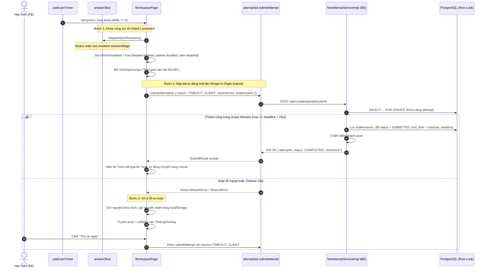

# TV3-09 — Hết giờ, khóa form và nộp một lần: Implementation Plan

> **For agentic workers:** Bắt buộc tuân thủ phương pháp luận `test-driven-development` (Red → Green → Refactor). Chỉ triển khai sau khi plan được phê duyệt. Không tự ý commit hoặc push code.

**Task ID:** TV3-09  
**Tiêu đề:** Hết giờ, khóa form và nộp một lần (Timeout, Form Lockdown & Single Idempotent Submission)  
**Ngày lập plan:** 2026-10-10  
**Tác giả:** Codex Architect & Planner  
**Trạng thái:** PLANNED  
**Đặc tả liên quan:** `docs/superpowers/specs/2026-10-08-tv3-00-contract-audit.md` (AC-07, BE-SUB-01, BE-TMO-01, BE-TMO-02, FE-OFF-01, FE-TMO-01), `docs/superpowers/specs/ndt/2026-10-02-sprint05-timer-and-submission-design.md`, `docs/superpowers/specs/ndt/2026-10-02-sprint05-timer-and-submission-ac-test.md` (AC-01..05, AC-07).

---

## 1. Task Overview and Scope

### 1.1 Mục tiêu (Goal)
Đảm bảo khi thời gian làm bài kết thúc (`countdown = 0` / `isExpired = true`):
1. **Khóa form toàn diện (Hard Form Lockdown):** Toàn bộ giao diện làm bài (các ô input, radio, checkbox, textarea, câu hỏi, bảng câu hỏi palette, tab chuyển section/part, nút nộp bài) lập tức bị vô hiệu hóa hoàn toàn; Redux state chặn triệt để mọi hành động chỉnh sửa đáp án hoặc cờ đánh dấu.
2. **Nộp một lần (Single In-Flight Submission):** Bảo đảm chỉ có duy nhất một request submit được gửi lên server tại một thời điểm qua client-side Mutex, loại bỏ hoàn toàn hiện tượng gửi đúp (double-click, StrictMode replay, tranh chấp giữa timer và nút nộp thủ công).
3. **Phân xử tranh chấp & Idempotency phía Server:** Sử dụng khóa dòng `PESSIMISTIC_WRITE` (`SELECT ... FOR UPDATE`), bảo đảm tranh chấp giữa Client Submit, Background Scheduler (`AttemptExpirationScheduler`), và Lazy Finalize (`getWorkspace`) diễn ra an toàn, không bao giờ chấm lại hay trừ quota 2 lần.
4. **Xử lý Grace Period 15 giây & Retry an toàn khi mất mạng:**
   - Client nộp timeout với `reason = TIMEOUT_CLIENT` trong khung giờ ân hạn 15s (`now <= deadline + 15s`).
   - Nếu gặp sự cố mạng (timeout 10s, mất mạng, lỗi 500): form vẫn giữ nguyên trạng thái khóa, modal hiển thị rõ thông báo lỗi kèm nút "Thử lại ngay" (`onRetry`), bảo toàn bản nháp local (`localStorage`), **tuyệt đối không điều hướng giả sang trang kết quả khi chưa có xác nhận từ server**.

### 1.2 Phạm vi (Scope)
- **In-Scope:**
  - **Backend:**
    - Kiểm thử đơn vị & kiểm thử tích hợp tranh chấp (concurrency IT) cho `submitAttempt` với row lock `PESSIMISTIC_WRITE`.
    - Kiểm thử ranh giới ân hạn 15 giây (`now <= deadline + 15s` vs `now > deadline + 15s`) và kiểm thử từ chối `MANUAL` / `autosaveAnswers` khi `now > deadline`.
    - Kiểm thử tranh chấp đồng thời giữa `AttemptExpirationScheduler` và `submitAttempt`.
  - **Frontend:**
    - Bổ sung cờ khóa `isLocked` / `isExpired` trong `answerSlice.ts`, vô hiệu hóa mutation trong reducer khi đã khóa.
    - Cập nhật `WorkspacePage.tsx`: bọc vùng câu hỏi trong `<fieldset disabled={isFormDisabled}>`, vô hiệu hóa `QuestionPalette`, tab part switcher, nút flag, và nút submit khi hết giờ.
    - Đồng bộ `TimeUpModal` / `TimeUpOverlay`: hiển thị lỗi kết nối khi submit thất bại, hỗ trợ nút "Thử lại ngay", loại bỏ việc tự chuyển trang kết quả khi submit lỗi.
    - Xây dựng client submission mutex (Ref lock) ngăn chặn gọi submit đồng thời.
- **Out-of-Scope:**
  - Thay đổi cấu trúc cơ sở dữ liệu (Flyway migration).
  - Tích hợp chi tiết Gemini AI grading worker (thuộc TV3-10+).
  - Giao diện xem lại bài thi Review/Result (đã thuộc TV3-07 / TV3-11).

---

## 2. Verified Repository Findings

1. **Backend Database & Row Lock:**
   - Bảng `test_attempts` đã có cột `status`, `deadline`, `end_time`, `version`.
   - `TestAttemptRepository.java` đã có phương thức khóa dòng:
     ```java
     @Lock(LockModeType.PESSIMISTIC_WRITE)
     @Query("SELECT a FROM TestAttempt a WHERE a.id = :id AND a.userId = :userId")
     Optional<TestAttempt> findByIdAndUserIdForUpdate(@Param("id") Integer id, @Param("userId") Integer userId);
     ```
2. **Backend Submission Logic:**
   - Trong `TestAttemptServiceImpl.java`:
     - Khi `attempt.getStatus() != AttemptStatus.IN_PROGRESS`, trả về ngay kết quả cũ (Idempotency) mà không chấm lại (lines 198-200).
     - Khi `reason == SubmitReason.MANUAL` và `now.isAfter(attempt.getDeadline())`, ném `AppException(ErrorCode.ATTEMPT_EXPIRED)` (line 208).
     - Khi `reason == SubmitReason.TIMEOUT_CLIENT` và `now.isAfter(attempt.getDeadline().plusSeconds(15))`, tự động chuyển sang `TIMEOUT_SERVER`, bỏ qua `finalAnswers` mới và chốt bài bằng đáp án đã autosave (lines 211-214).
     - Trong `autosaveAnswers`: đã có kiểm tra `Instant.now().isAfter(attempt.getDeadline())` ném `ATTEMPT_EXPIRED` (line 155).
3. **Backend Scheduler:**
   - `AttemptExpirationScheduler.java` chạy định kỳ mỗi 30 giây, quét các attempt `IN_PROGRESS` có `deadline < now - 15s` và gọi `expireAttemptBySystem(attempt.getId())`.
4. **Frontend Hiện Trạng & Khoảng Trống (Gaps):**
   - **Gaps 1 (Form chưa khóa cứng):** `<fieldset disabled={isCurrentSectionLocked}>` trong `WorkspacePage.tsx` chỉ kiểm tra section lock, chưa kiểm tra `isExpired` hoặc `isSubmitting`. Người học vẫn có thể click/tab vào các input hoặc sửa bài bằng phím khi modal hết giờ xuất hiện.
   - **Gaps 2 (Redux chưa chặn mutation):** `answerSlice.ts` không có trạng thái khóa; dispatches từ background hoặc script vẫn làm thay đổi `state.answers`.
   - **Gaps 3 (Lỗi mạng chuyển trang giả):** Trong `WorkspacePage.tsx` (lines 439-443), khi `handleSubmit` gặp lỗi mạng nhưng `isTimeout === true`, code vẫn thực hiện `setSubmitResultUrl(resultUrl)`. Sau đó `TimeUpModal` cho phép người dùng click "Xem kết quả thi" điều hướng sang `/result` dù server chưa từng nhận được bài thi!
   - **Gaps 4 (Thiếu wiring lỗi và retry):** `WorkspacePage.tsx` không truyền `error` và `onRetry` vào `TimeUpModal`, dẫn đến khi submit thất bại, modal không hiển thị nút thử lại.

---

## 3. Architecture and Data Flow

### 3.1 Luồng Xử Lý Hết Giờ (Timeout Lifecycle Flow)



### 3.2 Sơ Đồ Khóa Form Đa Tầng (Multi-Layer Form Lockdown)

```text
┌────────────────────────────────────────────────────────────────────────┐
│                        WorkspacePage Form Guard                        │
├────────────────────────────────────────────────────────────────────────┤
│ 1. UI Layer:                                                           │
│    - isFormDisabled = isExpired || isSubmitting || isTerminal || locked│
│    - <fieldset disabled={isFormDisabled}> bọc toàn bộ QuestionRenderer│
│    - QuestionPalette: disabled={isFormDisabled}                        │
│    - Section/Part Switcher: disabled={isFormDisabled}                  │
│    - Flag Button: disabled={isFormDisabled}                            │
│    - Submit Button: disabled={isSubmitting || isExpired}               │
│                                                                        │
│ 2. State Layer (Redux answerSlice):                                    │
│    - state.isLocked = true khi dispatch(lockAnswers())                │
│    - setAnswer / clearAnswer / toggleFlag kiểm tra !state.isLocked      │
│                                                                        │
│ 3. Network Layer:                                                      │
│    - Hủy / Dừng ngay lập tức chu kỳ Autosave ngầm khi isExpired        │
│    - Ref Mutex (isSubmittingRef) ngăn chặn mọi request submit trùng lặp│
└────────────────────────────────────────────────────────────────────────┘
```

---

## 4. API / DTO / Database Contracts

### 4.1 API Endpoints (Giữ nguyên, không thêm mới)

- **`POST /api/v1/attempts/{id}/submit`**
  - **Request Body (`SubmitAttemptRequest`):**
    ```json
    {
      "reason": "TIMEOUT_CLIENT",
      "baseVersion": 3,
      "finalAnswers": [
        {
          "part_id": 1,
          "answers": [
            { "question_id": "q1", "answer": "A" }
          ]
        }
      ]
    }
    ```
  - **Response (`SubmitResultResponse`):**
    ```json
    {
      "success": true,
      "data": {
        "attemptId": 42,
        "status": "COMPLETED",
        "redirectUrl": "/attempts/42/result"
      }
    }
    ```
  - **HTTP Status Codes:**
    - `200 OK`: Nộp bài thành công hoặc trả về kết quả đã nộp trước đó (Idempotent).
    - `409 CONFLICT` (`ATTEMPT_EXPIRED`): Nộp bài thủ công (`reason=MANUAL`) nhưng đã quá deadline.
    - `403 FORBIDDEN`: Không phải chủ sở hữu bài thi.

### 4.2 Frontend Redux Contract (`answerSlice.ts`)

```typescript
export interface AnswerState {
  answers: Record<number, Record<string, AnswerValue>>;
  flags: Record<number, string[]>;
  highlights: Record<number, HighlightRange[]>;
  isDirty: boolean;
  version: number;
  pendingVersion: number | null;
  saveStatus: 'idle' | 'saving' | 'saved' | 'error' | 'conflict';
  lastSavedAt: number | null;
  isLocked: boolean; // MỚI: cờ khóa toàn diện trạng thái trả lời
}
```

---

## 5. Exact File Change Matrix

| File Path | Action | Description |
|---|---|---|
| `frontend/src/features/exam/store/answerSlice.ts` | MODIFY | Thêm `isLocked` vào `AnswerState`, thêm action `lockAnswers()`, `unlockAnswers()`, chặn mutation trong `setAnswer`, `clearAnswer`, `toggleFlag`. |
| `frontend/src/features/exam/store/__tests__/answerSlice.test.ts` | MODIFY | Bổ sung unit test kiểm tra `lockAnswers()` chặn thành công các dispatch sửa đáp án / flag. |
| `frontend/src/features/exam/components/QuestionPalette.tsx` | MODIFY | Nhận prop `disabled?: boolean`, vô hiệu hóa click khi `disabled=true`. |
| `frontend/src/features/exam/components/TimeUpModal.tsx` | MODIFY | Nhận `error`, `onRetry`, truyền xuống `TimeUpOverlay`. |
| `frontend/src/features/exam/pages/WorkspacePage.tsx` | MODIFY | Áp dụng `isFormDisabled`, bọc fieldset disabled, khóa palette/tab/flag, client-side submit mutex, truyền error/onRetry cho TimeUpModal, xóa logic tự chuyển trang khi submit timeout lỗi. |
| `frontend/src/features/exam/__tests__/WorkspacePage.test.tsx` | MODIFY | Thêm các ca kiểm thử: form hard lock khi timeout, retry khi submit lỗi mạng, không chuyển result khi lỗi. |
| `frontend/src/features/exam/__tests__/timeoutAndSubmitContract.test.tsx` | CREATE | Integration test kiểm tra trọn vẹn luồng timeout: countdown chạm 0 → hard lock → submit 1 lần → retry lỗi mạng → thành công chuyển trang. |
| `backend/src/test/java/com/multilingo/backend/modules/testing/service/TestAttemptSubmitConcurrencyIT.java` | CREATE | Integration test kiểm tra tranh chấp đồng thời 2 request submit cho cùng 1 attempt: đúng 1 lần finalize & chấm điểm, request thứ hai trả kết quả cũ (idempotency). |
| `backend/src/test/java/com/multilingo/backend/modules/testing/service/TestAttemptSchedulerSubmitConcurrencyIT.java` | CREATE | Integration test kiểm tra tranh chấp đồng thời giữa `AttemptExpirationScheduler` và client `submitAttempt`. |
| `backend/src/test/java/com/multilingo/backend/modules/testing/service/TestAttemptGracePeriodTest.java` | CREATE | Unit test kiểm tra các ranh giới grace period: đúng deadline, trước 15s grace, sau 15s grace, và từ chối MANUAL quá hạn. |

---

## 6. Detailed Implementation Subtasks

### Subtask 1: TV3-09-01 — Backend Concurrency, Grace Period & Submit Idempotency Tests
- **Objective:** Viết bộ test tích hợp và unit test bao phủ toàn diện tính bất biến (idempotency), cơ chế khóa hàng `PESSIMISTIC_WRITE`, và quy tắc 15s grace period của backend.
- **Prerequisites:** TV3-07 hoàn tất.
- **Files:**
  - `backend/src/test/java/com/multilingo/backend/modules/testing/service/TestAttemptSubmitConcurrencyIT.java` (NEW)
  - `backend/src/test/java/com/multilingo/backend/modules/testing/service/TestAttemptSchedulerSubmitConcurrencyIT.java` (NEW)
  - `backend/src/test/java/com/multilingo/backend/modules/testing/service/TestAttemptGracePeriodTest.java` (NEW)
- **Step-by-step Instructions:**
  1. Tạo `TestAttemptSubmitConcurrencyIT.java`:
     - Khởi tạo attempt `IN_PROGRESS`.
     - Dùng `ExecutorService` bắn 2 threads đồng thời gọi `submitAttempt(attemptId, submitReq)` với `reason = TIMEOUT_CLIENT`.
     - Xác nhận cả 2 threads đều hoàn thành thành công mà không có deadlock, status chuyển thành `COMPLETED`, và phương thức chấm điểm (`ObjectiveGradingService`) chỉ được thực thi đúng 1 lần.
  2. Tạo `TestAttemptSchedulerSubmitConcurrencyIT.java`:
     - Khởi tạo attempt `IN_PROGRESS` có deadline quá hạn 20s.
     - Đồng thời chạy `scheduler.sweepExpiredAttempts()` và `testAttemptService.submitAttempt(...)`.
     - Xác nhận attempt kết thúc ở trạng thái `SUBMITTED`/`COMPLETED`/`EXPIRED`, không xảy ra exception không kiểm soát.
  3. Tạo `TestAttemptGracePeriodTest.java`:
     - Test 1: `reason = MANUAL` tại `now > deadline` → ném `AppException(ATTEMPT_EXPIRED)`.
     - Test 2: `reason = TIMEOUT_CLIENT` tại `now <= deadline + 15s` → chấp nhận `finalAnswers`, `endTime = min(now, deadline)`.
     - Test 3: `reason = TIMEOUT_CLIENT` tại `now > deadline + 15s` → chuyển sang `TIMEOUT_SERVER`, bỏ qua `finalAnswers` mới, chốt bằng đáp án cũ.
     - Test 4: `autosaveAnswers` tại `now > deadline` → ném `AppException(ATTEMPT_EXPIRED)`.
- **Command:** `.\mvnw.cmd "-Dtest=TestAttemptSubmitConcurrencyIT,TestAttemptSchedulerSubmitConcurrencyIT,TestAttemptGracePeriodTest" test` (cwd: `backend`)
- **Acceptance Criteria:** Toàn bộ các ca kiểm thử concurrency và boundary chạy PASS (exit 0).

---

### Subtask 2: TV3-09-02 — Frontend Redux Reducer Lockdown (`answerSlice.ts`)
- **Objective:** Cập nhật `answerSlice` để hỗ trợ cơ chế khóa bất biến khi hết giờ hoặc nộp bài.
- **Prerequisites:** Không.
- **Files:**
  - `frontend/src/features/exam/store/answerSlice.ts` (MODIFY)
  - `frontend/src/features/exam/store/__tests__/answerSlice.test.ts` (MODIFY)
- **Step-by-step Instructions:**
  1. Viết test trước (RED) trong `answerSlice.test.ts`:
     - Dispatch `lockAnswers()` làm `state.isLocked = true`.
     - Dispatch `setAnswer(...)`, `clearAnswer(...)`, `toggleFlag(...)` sau khi đã lock → state không thay đổi.
     - Dispatch `unlockAnswers()` làm `state.isLocked = false`.
  2. Cập nhật `answerSlice.ts`:
     - Thêm `isLocked: boolean` vào `initialState` (mặc định `false`).
     - Thêm reducers: `lockAnswers: (state) => { state.isLocked = true; }`, `unlockAnswers: (state) => { state.isLocked = false; }`.
     - Thêm guard `if (state.isLocked) return;` vào đầu các reducers: `setAnswer`, `clearAnswer`, `setAnswers`, `toggleFlag`.
     - Đảm bảo `hydrateWorkspace` reset `isLocked = false` trừ khi attempt ở trạng thái terminal.
- **Command:** `npm test -- src/features/exam/store/__tests__/answerSlice.test.ts` (cwd: `frontend`)
- **Acceptance Criteria:** Tests RED chuyển sang GREEN. State không bị sửa đổi khi `isLocked = true`.

---

### Subtask 3: TV3-09-03 — Comprehensive UI Hard Lockdown (`WorkspacePage.tsx`, `QuestionPalette.tsx`)
- **Objective:** Đảm bảo toàn bộ tương tác giao diện bị khóa cứng khi thời gian làm bài kết thúc.
- **Prerequisites:** TV3-09-02.
- **Files:**
  - `frontend/src/features/exam/components/QuestionPalette.tsx` (MODIFY)
  - `frontend/src/features/exam/pages/WorkspacePage.tsx` (MODIFY)
  - `frontend/src/features/exam/__tests__/QuestionPalette.test.tsx` (MODIFY)
  - `frontend/src/features/exam/__tests__/WorkspacePage.test.tsx` (MODIFY)
- **Step-by-step Instructions:**
  1. Cập nhật `QuestionPalette.tsx`:
     - Thêm prop `disabled?: boolean`.
     - Nếu `disabled=true`, vô hiệu hóa các nút câu hỏi (`button disabled`), không kích hoạt `onSelectQuestion`.
  2. Cập nhật `WorkspacePage.tsx`:
     - Khai báo biến kiểm soát khóa:
       ```typescript
       const isFormDisabled = isExpired || isSubmitting || isCurrentSectionLocked || activeWorkspace?.status !== 'IN_PROGRESS';
       ```
     - Khi `isExpired` chuyển thành `true`: lập tức gọi `dispatch(lockAnswers())`.
     - Bọc danh sách câu hỏi: `<fieldset disabled={isFormDisabled} className="m-0 min-w-0 border-0 p-0">`.
     - Cập nhật nút Flag: `disabled={isFormDisabled}`.
     - Cập nhật nút chuyển Part: `disabled={isFormDisabled || isLocked}`.
     - Truyền `disabled={isFormDisabled}` vào `<QuestionPalette ... />`.
     - Nút nộp bài: `disabled={isSubmitting || isExpired}`.
  3. Viết test trong `WorkspacePage.test.tsx` xác nhận khi timer hết giờ:
     - Fieldset câu hỏi có thuộc tính `disabled`.
     - Click vào radio/input không kích hoạt thay đổi.
     - Palette câu hỏi bị vô hiệu hóa.
- **Command:** `npm test -- src/features/exam/__tests__/WorkspacePage.test.tsx src/features/exam/__tests__/QuestionPalette.test.tsx` (cwd: `frontend`)
- **Acceptance Criteria:** Các phần tử UI bị khóa hoàn toàn khi `isExpired = true`.

---

### Subtask 4: TV3-09-04 — Single In-Flight Submit Mutex & Network Failure Handling
- **Objective:** Ngăn chặn việc nộp bài đồng thời bằng client-side mutex và xử lý lỗi mạng an toàn khi nộp bài lúc hết giờ.
- **Prerequisites:** TV3-09-03.
- **Files:**
  - `frontend/src/features/exam/components/TimeUpModal.tsx` (MODIFY)
  - `frontend/src/features/exam/pages/WorkspacePage.tsx` (MODIFY)
  - `frontend/src/features/exam/__tests__/TimeUpOverlay.test.tsx` (MODIFY)
  - `frontend/src/features/exam/__tests__/WorkspacePage.test.tsx` (MODIFY)
- **Step-by-step Instructions:**
  1. Cập nhật `TimeUpModal.tsx`:
     - Nhận các props: `error?: string | null`, `onRetry?: () => void`.
     - Truyền `error` và `onRetry` xuống `TimeUpOverlay`.
  2. Cập nhật `WorkspacePage.tsx`:
     - Thêm `submitLockRef = useRef<boolean>(false)` làm mutex chống nộp đúp:
       ```typescript
       if (submitLockRef.current) return;
       submitLockRef.current = true;
       ```
     - Trong khối `finally` của `handleSubmit`: giải phóng `submitLockRef.current = false`.
     - Trong nhánh xử lý `isTimeout`:
       - Khi gọi `submitAttempt`, gửi trực tiếp `reason: 'TIMEOUT_CLIENT'`, `baseVersion`, và `finalAnswers` trích xuất từ state hiện tại (không gọi thêm pre-submit PUT autosave nếu đã hết giờ).
       - Trong khối `catch (err)`:
         - Lưu thông báo lỗi vào state `submitError` (ví dụ: `'Kết nối không ổn định, vui lòng thử lại'`).
         - **Không tạo result trong nhánh lỗi.** Chỉ nhận result qua receipt validation hiện có: envelope thành công có data, đúng attempt, status hợp lệ khác `IN_PROGRESS` và redirect chính xác `/attempts/<id>/result`. HTTP 409 (kể cả `ATTEMPT_EXPIRED` hoặc code `1601`) không xác nhận đã finalize; giữ draft và hiển thị lỗi/retry hoặc authoritative reload theo mã lỗi.
         - Bảo toàn `localStorage` draft (không gọi `removeItem`).
     - Truyền `error={submitError}` và `onRetry={() => handleSubmit(true)}` vào `<TimeUpModal ... />`.
  3. Viết tests:
     - Test chặn click đúp nộp bài: gọi `handleSubmit` 2 lần chỉ kích hoạt đúng 1 request API.
     - Test lỗi mạng khi timeout: giả lập `submitAttempt` reject, kiểm tra modal hiển thị lỗi, draft còn nguyên trong localStorage, không chuyển trang kết quả, click "Thử lại ngay" kích hoạt retry với `reason = 'TIMEOUT_CLIENT'`.
- **Command:** `npm test -- src/features/exam/__tests__/WorkspacePage.test.tsx src/features/exam/__tests__/TimeUpOverlay.test.tsx` (cwd: `frontend`)
- **Acceptance Criteria:** Mutex chặn nộp đúp; lỗi mạng hiển thị retry và bảo toàn draft, chỉ chuyển trang khi có xác nhận.

---

### Subtask 5: TV3-09-05 — Full Integration & Regression Verification
- **Objective:** Viết kịch bản kiểm thử tích hợp đầu cuối (E2E Contract Test) và chạy toàn bộ regression suite để nghiệm thu feature.
- **Prerequisites:** TV3-09-01 đến TV3-09-04 hoàn tất.
- **Files:**
  - `frontend/src/features/exam/__tests__/timeoutAndSubmitContract.test.tsx` (NEW)
- **Step-by-step Instructions:**
  1. Tạo `timeoutAndSubmitContract.test.tsx`:
     - Render `WorkspacePage` với exam mock test có deadline.
     - Mô phỏng đồng hồ đếm ngược về 0 (`advanceTimersByTime`).
     - Xác nhận form bị hard lock, Redux không nhận thay đổi, và `submitAttempt` được gọi với `TIMEOUT_CLIENT`.
     - Mô phỏng lần nộp đầu tiên bị lỗi mạng (network error) → xác nhận hiển thị nút "Thử lại ngay", không chuyển trang.
     - Mô phỏng bấm nút "Thử lại ngay" → lần này API trả về receipt hợp lệ → xác nhận chỉ lúc này mới mở kết quả; giữ `exam_draft_<id>` sau success. Receipt không xác nhận riêng rằng `finalAnswers` mới đã được dùng; restore vẫn chỉ từ backend, không merge draft vào Redux.
  2. Chạy toàn bộ bộ kiểm thử Backend liên quan:
     - `.\mvnw.cmd "-Dtest=TestAttemptSubmitConcurrencyIT,TestAttemptSchedulerSubmitConcurrencyIT,TestAttemptGracePeriodTest,TestAttemptResumeConcurrencyIT,TestAttemptResumeControllerIT" test`
  3. Chạy toàn bộ bộ kiểm thử Frontend:
     - `npm test -- src/features/exam/__tests__/timeoutAndSubmitContract.test.tsx`
     - `npm test`
     - `npm run lint`
     - `npm run build`
- **Acceptance Criteria:** Tất cả các tests mới và cũ đều PASS (exit 0). Không có lỗi build hay lint mới.

---

## 7. Focused Test Matrix and Commands

| Test ID | Tầng | Kịch bản kiểm thử | Kỳ vọng |
|---|---|---|---|
| TC_BE_SUB_01 | Backend IT | Hai request submit đồng thời trên cùng 1 attempt | 1 transaction finalize & grade, request 2 trả kết quả cũ (idempotent), không deadlock |
| TC_BE_SCH_01 | Backend IT | Scheduler sweep chạy đồng thời với Client submit | Đúng 1 transaction đóng bài thành công |
| TC_BE_GRC_01 | Backend Unit | Submit `TIMEOUT_CLIENT` tại `now <= deadline + 15s` | Thành công, lưu `finalAnswers`, `endTime = min(now, deadline)` |
| TC_BE_GRC_02 | Backend Unit | Submit `TIMEOUT_CLIENT` tại `now > deadline + 15s` | Tự động hạ cấp thành `TIMEOUT_SERVER`, bỏ qua `finalAnswers` |
| TC_BE_MAN_01 | Backend Unit | Submit `MANUAL` tại `now > deadline` | Ném `AppException(ATTEMPT_EXPIRED)` (HTTP 409) |
| TC_BE_SAV_01 | Backend Unit | Autosave tại `now > deadline` | Ném `AppException(ATTEMPT_EXPIRED)` (HTTP 409) |
| TC_FE_LCK_01 | Frontend Redux | Dispatch sau khi gọi `lockAnswers()` | State answers và flags không bị thay đổi |
| TC_FE_UI_01 | Frontend UI | Timer hết giờ (`isExpired = true`) | Fieldset disabled, palette disabled, tabs disabled, nút submit disabled |
| TC_FE_MTX_01 | Frontend UI | Double click nút submit hoặc timeout gọi đúp | Client-side Mutex chỉ gửi đúng 1 request API |
| TC_FE_NET_01 | Frontend UI | Submit timeout gặp lỗi mạng | Hiển thị thông báo lỗi, nút "Thử lại ngay", không xóa draft, không chuyển trang kết quả |
| TC_FE_RTY_01 | Frontend UI | Click "Thử lại ngay" sau khi lỗi mạng | Gửi lại submit với `reason = 'TIMEOUT_CLIENT'`, thành công mới chuyển trang |

**Commands kiểm thử tập trung:**
- **Backend:**
  ```powershell
  .\mvnw.cmd "-Dtest=TestAttemptSubmitConcurrencyIT,TestAttemptSchedulerSubmitConcurrencyIT,TestAttemptGracePeriodTest" test
  ```
- **Frontend:**
  ```bash
  npm test -- src/features/exam/__tests__/timeoutAndSubmitContract.test.tsx src/features/exam/__tests__/WorkspacePage.test.tsx src/features/exam/__tests__/TimeUpOverlay.test.tsx src/features/exam/store/__tests__/answerSlice.test.ts
  ```

---

## 8. Security and Compatibility Rules

1. **Security (An toàn dữ liệu):**
   - Mọi thao tác submit đều kiểm tra quyền sở hữu qua `IdentityAdapter` / `userId`.
   - Đáp án nộp lên tuân thủ chặt chẽ whitelist schema.
   - Không log thông tin nhạy cảm (token, mật khẩu, toàn văn bài làm essay) vào application log.
2. **Compatibility (Tương thích ngược):**
   - Không thay đổi URL các API hiện có: `POST /api/v1/attempts/{id}/submit` giữ nguyên định dạng request/response.
   - Giữ nguyên cơ chế retry của `axiosClient`.
   - Tương thích hoàn toàn với các luồng Practice Mode (Practice không có deadline, `isExpired` luôn là `false`, không bị thu bài tự động).

---

## 9. Dependencies, Risks, and Blockers

- **Dependencies:**
  - TV3-08 hoàn tất để tái sử dụng các tiện ích `answerSnapshot.ts` và `answerDraft.ts`.
- **Rủi ro & Biện pháp giảm thiểu:**
  - *Rủi ro:* Tranh chấp khóa cơ sở dữ liệu (Deadlock) giữa scheduler và submit client.  
    *Biện pháp:* Cả hai luồng đều tuân thủ thứ tự khóa dòng duy nhất: `test_attempts` trước, sau đó mới cập nhật `attempt_answers`.
  - *Rủi ro:* Học viên bị mất bài khi mạng chập chờn lúc hết giờ.  
    *Biện pháp:* Lưu bản sao đáp án vào `localStorage` trước khi gửi request; nếu storage thất bại thì hiển thị warning. Không xóa draft chỉ vì submit trả receipt thành công: attempt đã đóng hoặc timeout sau grace có thể bỏ qua `finalAnswers` mới. Draft là bản dự phòng, không phải nguồn restore chính thức.

---

## 10. Definition of Done (DoD)

1. Đã triển khai đầy đủ 5 subtasks từ TV3-09-01 đến TV3-09-05.
2. Tất cả 11 kịch bản kiểm thử trong Test Matrix đều PASS.
3. Không làm gãy bất kỳ regression test nào của TV3-04..TV3-08.
4. Lệnh kiểm tra frontend `npm test`, `npm run lint`, `npm run build` đều PASS không có lỗi.
5. Handoff ledger `TV3-09-handoff.md` được ghi nhận đầy đủ theo từng subtask.
6. Hiển thị tóm tắt diff và xin xác nhận của người dùng trước khi thực hiện bất kỳ commit nào.

## 2026-10-10 — Điều chỉnh giới hạn cho P1 R1/R2/R3

Theo yêu cầu FIX chỉ P0/P1, các chỉ dẫn sau áp dụng cho delta R3 và ưu tiên hơn pseudocode lock không có scope trong bản plan ban đầu:

- Giữ nguyên AnswerState và pipeline TV3-08; chỉ thêm `isLocked: boolean`, `lockAnswers({ attemptId, contextRevision })` và `unlockAnswers` cùng scope. Mỗi authoritative hydration reset lock theo status/deadline backend; `clearAnswers` vẫn teardown bình thường. Response hoặc unlock thuộc revision cũ không tác động context mới.
- Guard `setAnswer`, `toggleFlag`, `clearFlags`, `addHighlightRecord`, `removeHighlightRecord` khi locked. Không chặn `setAttemptContext`, acknowledgment/error/cancellation của save hoặc `clearAnswers`.
- `useAttemptSubmission.ts` dùng mutex hiện có, khóa Redux trước await đầu tiên; lỗi manual trước deadline mở editing lại. Timeout, expiry hoặc receipt thành công giữ read-only. Cleanup chỉ giải phóng khóa manual tạm thời đúng context; không mở khóa context mới. Không thêm mutex/page submit pipeline thứ hai.
- `useWorkspace.ts` hydrate expired/terminal context ở trạng thái locked; `WorkspacePage.tsx` khóa scoped ngay khi timer hết giờ, kể cả khi barrier/conflict chặn POST. Không hủy PUT đang chạy chỉ vì expiry.
- Focused regression tái sử dụng tests thật tại `frontend/src/features/exam/__tests__/answerSlice.test.ts`, `useWorkspace.test.tsx`, `useAttemptSubmission.test.tsx`, `autosaveSubmitContract.test.tsx`. Integration dùng page/hooks/reducer/API normalizer thật, chỉ mock HTTP/browser; thử dispatch trực tiếp khi waiting PUT/timeout error, stale completion, manual unlock/retry, HTTP 409 không result và giữ draft sau receipt không có snapshot acknowledgment.

Lệnh focused (cwd `frontend`): `npm test -- src/features/exam/__tests__/answerSlice.test.ts src/features/exam/__tests__/useWorkspace.test.tsx src/features/exam/__tests__/useAttemptSubmission.test.tsx src/features/exam/__tests__/autosaveSubmitContract.test.tsx`.

R4/R5/R6 (P2) chưa được sửa hoặc nghiệm thu trong lượt FIX này. Phần điều chỉnh này không tuyên bố hoàn thành toàn bộ TV3-09, không thay API/backend/schema và không cho phép commit/push.

---

## 11. Gemini Execution Instructions

1. Thực hiện nghiêm ngặt theo chu trình TDD (Red → Green → Refactor).
2. Kiểm tra branch hiện tại (`feature/TV3-00-contract-audit`) và bảo toàn các file uncommitted/untracked hiện có.
3. Thực hiện tuần tự Subtask 1 → Subtask 2 → Subtask 3 → Subtask 4 → Subtask 5.
4. Sau mỗi subtask, chạy đúng lệnh test được chỉ định và cập nhật kết quả vào `docs/superpowers/plans/ndt/TV3-09-handoff.md` với trạng thái `IMPLEMENTED`.
5. Dừng lại sau khi hoàn thành subtask và chờ Codex Reviewer kiểm tra trước khi chuyển sang task tiếp theo.

---

## 12. Codex Review Checklist

- [ ] Phía Backend: Khóa dòng `PESSIMISTIC_WRITE` có bao trùm toàn bộ quá trình đọc trạng thái, lưu đáp án và chấm điểm không?
- [ ] Phía Backend: Submit lặp lại có trả về kết quả cũ mà không gọi lại grading service hay không?
- [ ] Phía Frontend: `<fieldset disabled={isFormDisabled}>` có thực sự vô hiệu hóa các native inputs khi `isExpired=true` không?
- [ ] Phía Frontend: Khi submit gặp lỗi mạng, `submitResultUrl` có bị set nhầm hay trang có bị navigate nhầm không?
- [ ] Phía Frontend: Nút "Thử lại ngay" có gửi đúng `reason = 'TIMEOUT_CLIENT'` không?
- [ ] Bản nháp `localStorage` có được bảo toàn khi request submit gặp sự cố không?

---

## 13. Out-of-Scope Follow-up Issues

1. **TV3-10 / TV3-11:** Giao diện chi tiết cho việc hiển thị điểm số và Review bài thi sau khi nộp (Exam Result & Review Page integration).
2. **TV3-12:** Xây dựng worker xử lý chấm bài tự luận Writing với Google Gemini AI khi trạng thái bài thi chuyển sang `AI_GRADING`.
