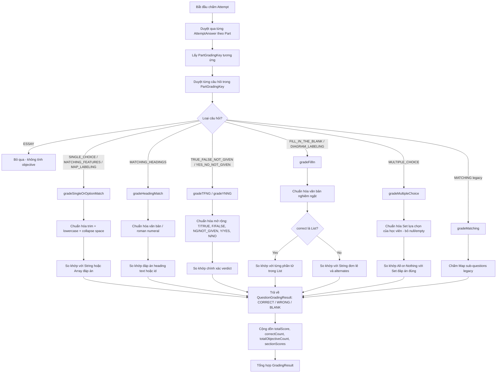

# TV3-10 — Chính xác hóa objective grading: Implementation Plan

> **For agentic workers:** Bắt buộc tuân thủ phương pháp luận `test-driven-development` (Red → Green → Refactor). Chỉ triển khai sau khi plan được phê duyệt. Không tự ý commit hoặc push code.

**Task ID:** TV3-10  
**Tiêu đề:** Chính xác hóa objective grading (Accurizing & Correcting Objective Grading Engine & Adapters)  
**Ngày lập plan:** 2026-10-10  
**Tác giả:** Codex Architect & Planner  
**Trạng thái:** PLANNED  
**Đặc tả liên quan:** `docs/superpowers/specs/2026-10-08-tv3-00-contract-audit.md` (AC-08, BE-GRD-01, BE-GRD-02, P0-1, P1-1, P1-2), `docs/ndt/contracts/content-data-schema.md` (M00-01).

---

## 1. Task Overview and Scope

### 1.1 Mục tiêu (Goal)
Khắc phục triệt để các khoảng trống và lỗi logic trong engine chấm điểm khách quan `ObjectiveGradingServiceImpl` và adapter `DbGradingAdapter`, bảo đảm:
1. **Hỗ trợ đầy đủ tất cả loại câu canonical:** Bổ sung `MATCHING_FEATURES` và `MATCHING_HEADINGS` vào engine; chấm điểm chuẩn xác theo từng câu độc lập mà không quăng lỗi `GRADING_DATA_ERROR: Unknown question type`.
2. **Hỗ trợ mảng đáp án chấp nhận cho FILL_IN & DIAGRAM:** Khắc phục lỗi nghiêm trọng khi `correct_answer` trong database là một mảng `string[]` (ví dụ `["plasticity", "neural plasticity", "neuroplasticity"]`). Hiện tại engine chuyển mảng thành chuỗi `"[plasticity, ...]"` dẫn đến chấm sai toàn bộ câu đúng của học viên.
3. **Chuẩn hóa chuỗi nghiêm ngặt & linh hoạt:** Thu gọn khoảng trắng thừa (`\s+` $\rightarrow$ `" "`), hỗ trợ viết tắt (`T`/`F`/`NG` và `Y`/`N`/`NG`) cho các dạng True/False/Not Given và Yes/No/Not Given để tránh phạt oan học viên.
4. **Bảo toàn tính bất biến & an toàn:** Giữ All-or-Nothing cho `MULTIPLE_CHOICE` (1.0 điểm khi chọn đúng 100% tập đáp án, 0.0 điểm khi thiếu hoặc sai); bảo toàn tương thích ngược cho dạng `MATCHING` (legacy Map-based); bỏ qua an toàn câu `ESSAY`.

### 1.2 Phạm vi (Scope)
- **In-Scope:**
  - `ObjectiveGradingServiceImpl.java`: Mở rộng enum/set hỗ trợ, hàm chuẩn hóa văn bản, xử lý mảng đáp án cho `gradeFillIn`, bổ sung dispatch cho `MATCHING_FEATURES`, `MATCHING_HEADINGS`, `MAP_LABELING`, và gia cố `MULTIPLE_CHOICE`.
  - `DbGradingAdapter.java`: Xác nhận và bổ sung việc trích xuất `correct_answer` mảng và các loại câu canonical từ `question_groups`.
  - `ObjectiveGradingServiceTest.java`: Bổ sung toàn bộ unit test bao phủ các kịch bản chuẩn hóa, mảng đáp án, và các dạng câu hỏi mới.
  - `DbGradingAdapterTest.java`: Bổ sung kiểm thử tích hợp adapter với JSON đề thi đầy đủ các dạng câu.
- **Out-of-Scope:**
  - Logic gọi Google Gemini AI chấm bài tự luận Writing (thuộc TV3-12).
  - Giao diện Result & Review Page hiển thị giải thích chi tiết (thuộc TV3-11).
  - Thay đổi cấu trúc cơ sở dữ liệu PostgreSQL / Flyway migration.

---

## 2. Verified Repository Findings

1. **Bug 1 — Thiếu Question Types Canonical trong Engine:**
   - Trong `ObjectiveGradingServiceImpl.java` (line 21-25):
     ```java
     private static final Set<String> OBJECTIVE_TYPES = Set.of(
         "SINGLE_CHOICE", "TRUE_FALSE_NOT_GIVEN", "YES_NO_NOT_GIVEN",
         "FILL_IN_THE_BLANK", "MULTIPLE_CHOICE", "MATCHING",
         "DIAGRAM_LABELING", "MAP_LABELING"
     );
     ```
   - Hoàn toàn thiếu `MATCHING_FEATURES` và `MATCHING_HEADINGS`! Khi đề thi chứa 2 dạng này, line 68 ném `AppException(ErrorCode.GRADING_DATA_ERROR)` gây vỡ transaction nộp bài.
2. **Bug 2 — Lỗi Chấm Sai Array `correct_answer`:**
   - Trong `content-data-schema.md` (§2.4), `FILL_IN_THE_BLANK` và `DIAGRAM_LABELING` có `correct_answer` là `string[]`.
   - `DbGradingAdapter.java` nạp `key.setCorrect(question.get("correct_answer"))` $\rightarrow$ `List<String>`.
   - Trong `ObjectiveGradingServiceImpl.java` (line 170):
     ```java
     String correct = normalize(key.getCorrect().toString());
     if (userAns.equals(correct)) return QuestionGradingResult.correct(questionId);
     ```
   - Khi `key.getCorrect()` là `List<String>`, `toString()` biến thành chuỗi `"[item1, item2]"`. Câu trả lời `"item1"` của học viên so khớp với `"[item1, item2]"` luôn trả về `WRONG`!
3. **Bug 3 — True/False/Not Given Chưa Hỗ Trợ Viết Tắt:**
   - Học viên gõ `T`, `F`, `NG` bị coi là sai khi đáp án là `TRUE`, `FALSE`, `NOT_GIVEN`.
4. **Bug 4 — Khoảng Trắng Thừa (Multi-space):**
   - Học viên vô tình gõ hai khoảng trắng `"new   york"` không khớp với `"new york"` dù nội dung hoàn toàn đúng.
5. **Hiện Trạng Adapter:**
   - `DbGradingAdapter` đã hỗ trợ đọc cấu trúc lồng `question_groups[].questions[]`, loại bỏ câu `ESSAY`, và bắt trùng lặp `question_id`.

---

## 3. Architecture and Data Flow

### 3.1 Sơ Đồ Phân Phối Chấm Điểm (Grading Engine Dispatch Flow)



---

## 4. API / DTO / Database Contracts

### 4.1 Bộ Enum và DTO Giữ Nguyên

- **`GradingVerdict`:**
  - `CORRECT`: Điểm 1.0 (hoặc điểm tối đa câu).
  - `WRONG`: Điểm 0.0 (học viên có trả lời nhưng không khớp đáp án).
  - `BLANK`: Điểm 0.0 (học viên không trả lời, null, chuỗi rỗng hoặc chỉ có khoảng trắng).
- **`GradingKey`:**
  - `type`: String (hỗ trợ 10 canonical types + legacy MATCHING).
  - `correct`: Object (hỗ trợ String, List<String>, hoặc Map<String, String>).
  - `alternates`: List<String> (tùy chọn).
- **`QuestionGradingResult`:**
  - `questionId`: String
  - `verdict`: GradingVerdict
  - `score`: BigDecimal

---

## 5. Exact File Change Matrix

| File Path | Action | Description |
|---|---|---|
| `backend/src/main/java/com/multilingo/backend/modules/testing/grading/impl/ObjectiveGradingServiceImpl.java` | MODIFY | Mở rộng `OBJECTIVE_TYPES` với `MATCHING_FEATURES`, `MATCHING_HEADINGS`; cải tiến `normalize`, `normalizeTFNG`, `normalizeYNNG`; sửa `gradeFillIn` duyệt mảng `correct_answer`; cải tiến `gradeMultipleChoice` lọc null/empty. |
| `backend/src/test/java/com/multilingo/backend/modules/testing/grading/ObjectiveGradingServiceTest.java` | MODIFY | Bổ sung unit test cho tất cả các dạng câu mới, mảng đáp án fill-in, chuẩn hóa viết tắt T/F/NG, thu gọn space, và robustness test. |
| `backend/src/test/java/com/multilingo/backend/modules/testing/adapter/impl/DbGradingAdapterTest.java` | MODIFY | Bổ sung test kiểm tra `loadPartKeys` trích xuất chính xác các loại câu canonical mới và bảo toàn mảng `correct_answer`. |

---

## 6. Detailed Implementation Subtasks

### Subtask 1: TV3-10-01 — String Normalization Engine Enhancement
- **Objective:** Nâng cấp các hàm chuẩn hóa chuỗi trong `ObjectiveGradingServiceImpl` để thu gọn khoảng trắng thừa và hỗ trợ viết tắt cho True/False/Not Given và Yes/No/Not Given.
- **Files:**
  - `backend/src/main/java/com/multilingo/backend/modules/testing/grading/impl/ObjectiveGradingServiceImpl.java` (MODIFY)
  - `backend/src/test/java/com/multilingo/backend/modules/testing/grading/ObjectiveGradingServiceTest.java` (MODIFY)
- **Step-by-step Instructions:**
  1. Viết test trước (RED) trong `ObjectiveGradingServiceTest.java`:
     - Test khoảng trắng thừa: `"new   york"` so khớp `"new york"` $\rightarrow$ CORRECT.
     - Test TFNG viết tắt: `"T"` so khớp `"TRUE"`, `"F"` so khớp `"FALSE"`, `"NG"` so khớp `"NOT_GIVEN"` $\rightarrow$ CORRECT.
     - Test YNNG viết tắt: `"Y"` so khớp `"YES"`, `"N"` so khớp `"NO"`, `"NG"` so khớp `"NOT_GIVEN"` $\rightarrow$ CORRECT.
  2. Triển khai trong `ObjectiveGradingServiceImpl.java`:
     - Cập nhật hàm `normalize(Object raw)`:
       ```java
       private String normalize(Object raw) {
           if (raw == null) return null;
           String s = raw.toString().trim().toLowerCase(Locale.ROOT).replaceAll("\\s+", " ");
           return s.isEmpty() ? null : s;
       }
       ```
     - Cập nhật hàm `normalizeTFNG(Object raw)`:
       ```java
       private String normalizeTFNG(Object raw) {
           String s = normalize(raw);
           if (s == null) return null;
           s = s.replace(" ", "_");
           return switch (s) {
               case "t", "true" -> "true";
               case "f", "false" -> "false";
               case "ng", "not_given" -> "not_given";
               default -> s;
           };
       }
       ```
     - Cập nhật hàm `normalizeYNNG(Object raw)`:
       ```java
       private String normalizeYNNG(Object raw) {
           String s = normalize(raw);
           if (s == null) return null;
           s = s.replace(" ", "_");
           return switch (s) {
               case "y", "yes" -> "yes";
               case "n", "no" -> "no";
               case "ng", "not_given" -> "not_given";
               default -> s;
           };
       }
       ```
- **Command:** `.\mvnw.cmd "-Dtest=ObjectiveGradingServiceTest" test` (cwd: `backend`)
- **Acceptance Criteria:** Tất cả tests chuẩn hóa chuỗi và viết tắt đều PASS.

---

### Subtask 2: TV3-10-02 — Accepted Answers Array Support for FILL_IN_THE_BLANK & DIAGRAM_LABELING
- **Objective:** Sửa lỗi nghiêm trọng trong `gradeFillIn` khi `key.getCorrect()` là một `List<String>` chứa danh sách đáp án được chấp nhận.
- **Files:**
  - `backend/src/main/java/com/multilingo/backend/modules/testing/grading/impl/ObjectiveGradingServiceImpl.java` (MODIFY)
  - `backend/src/test/java/com/multilingo/backend/modules/testing/grading/ObjectiveGradingServiceTest.java` (MODIFY)
- **Step-by-step Instructions:**
  1. Viết test trước (RED) trong `ObjectiveGradingServiceTest.java`:
     - Test `FILL_IN_THE_BLANK` với `key.setCorrect(List.of("plasticity", "neural plasticity", "neuroplasticity"))`:
       - Học viên trả lời `"Plasticity"` $\rightarrow$ CORRECT (1.0 điểm).
       - Học viên trả lời `"Neural   plasticity"` $\rightarrow$ CORRECT (1.0 điểm).
       - Học viên trả lời `"brain plasticity"` $\rightarrow$ WRONG (0.0 điểm).
       - Học viên để trống `""` hoặc `null` $\rightarrow$ BLANK (0.0 điểm).
     - Test `DIAGRAM_LABELING` với mảng đáp án tương tự.
  2. Triển khai trong `ObjectiveGradingServiceImpl.java`:
     - Viết lại hàm `gradeFillIn`:
       ```java
       private QuestionGradingResult gradeFillIn(String questionId, GradingKey key, Object rawAnswer) {
           String userAns = normalize(rawAnswer);
           if (userAns == null) return QuestionGradingResult.blank(questionId);

           Object correctObj = key.getCorrect();
           if (correctObj instanceof Collection<?> coll) {
               for (Object opt : coll) {
                   if (userAns.equals(normalize(opt))) {
                       return QuestionGradingResult.correct(questionId);
                   }
               }
           } else if (correctObj != null) {
               if (userAns.equals(normalize(correctObj))) {
                   return QuestionGradingResult.correct(questionId);
               }
           }

           List<String> alternates = key.getAlternates();
           if (alternates != null) {
               for (String alt : alternates) {
                   if (userAns.equals(normalize(alt))) {
                       return QuestionGradingResult.correct(questionId);
                   }
               }
           }

           return QuestionGradingResult.wrong(questionId);
       }
       ```
- **Command:** `.\mvnw.cmd "-Dtest=ObjectiveGradingServiceTest" test` (cwd: `backend`)
- **Acceptance Criteria:** `gradeFillIn` so khớp chính xác với mọi biến thể trong `correct_answer` dạng mảng; không còn lỗi so khớp với `toString()` của List.

---

### Subtask 3: TV3-10-03 — Canonical Types Dispatch for MATCHING_FEATURES, MATCHING_HEADINGS & MAP_LABELING
- **Objective:** Thêm `MATCHING_FEATURES` và `MATCHING_HEADINGS` vào engine, phân phối chấm điểm chính xác cho từng câu hỏi theo chuẩn canonical schema.
- **Files:**
  - `backend/src/main/java/com/multilingo/backend/modules/testing/grading/impl/ObjectiveGradingServiceImpl.java` (MODIFY)
  - `backend/src/test/java/com/multilingo/backend/modules/testing/grading/ObjectiveGradingServiceTest.java` (MODIFY)
- **Step-by-step Instructions:**
  1. Viết test trước (RED) trong `ObjectiveGradingServiceTest.java`:
     - Test `MATCHING_FEATURES`: `correct = "B"`, user = `"b"` $\rightarrow$ CORRECT; user = `"C"` $\rightarrow$ WRONG; user = `null` $\rightarrow$ BLANK.
     - Test `MATCHING_HEADINGS`: `correct = "Section A"` (hoặc `"i"`), user = `"section a"` $\rightarrow$ CORRECT; user = `"Section B"` $\rightarrow$ WRONG.
     - Test `MAP_LABELING`: `correct = "D"`, user = `"D"` $\rightarrow$ CORRECT; user = `"A"` $\rightarrow$ WRONG.
     - Xác nhận không có ngoại lệ `GRADING_DATA_ERROR` nào bị ném ra cho các loại câu này.
  2. Triển khai trong `ObjectiveGradingServiceImpl.java`:
     - Cập nhật `OBJECTIVE_TYPES`:
       ```java
       private static final Set<String> OBJECTIVE_TYPES = Set.of(
           "SINGLE_CHOICE", "TRUE_FALSE_NOT_GIVEN", "YES_NO_NOT_GIVEN",
           "FILL_IN_THE_BLANK", "MULTIPLE_CHOICE", "MATCHING",
           "MATCHING_FEATURES", "MATCHING_HEADINGS",
           "DIAGRAM_LABELING", "MAP_LABELING"
       );
       ```
     - Cập nhật `switch (type)` trong `gradeQuestion`:
       ```java
       case "SINGLE_CHOICE", "MATCHING_FEATURES", "MATCHING_HEADINGS", "MAP_LABELING" ->
           gradeFillIn(questionId, key, rawAnswer); // gradeFillIn hỗ trợ cả string đơn lẻ lẫn array đáp án
       case "TRUE_FALSE_NOT_GIVEN" -> gradeTFNG(questionId, key, rawAnswer);
       case "YES_NO_NOT_GIVEN" -> gradeYNNG(questionId, key, rawAnswer);
       case "FILL_IN_THE_BLANK", "DIAGRAM_LABELING" ->
           gradeFillIn(questionId, key, rawAnswer);
       case "MULTIPLE_CHOICE" -> gradeMultipleChoice(questionId, key, rawAnswer);
       case "MATCHING" -> gradeMatching(questionId, key, rawAnswer);
       ```
- **Command:** `.\mvnw.cmd "-Dtest=ObjectiveGradingServiceTest" test` (cwd: `backend`)
- **Acceptance Criteria:** Cả 3 loại câu mới đều được chấm chính xác 1.0/0.0 điểm mà không gặp lỗi Unknown Type.

---

### Subtask 4: TV3-10-04 — MULTIPLE_CHOICE & Legacy MATCHING Robustness Guard
- **Objective:** Gia cố an toàn cho `gradeMultipleChoice` và `gradeMatching` trước các dữ liệu rác, null, hoặc kiểu dữ liệu không chuẩn.
- **Files:**
  - `backend/src/main/java/com/multilingo/backend/modules/testing/grading/impl/ObjectiveGradingServiceImpl.java` (MODIFY)
  - `backend/src/test/java/com/multilingo/backend/modules/testing/grading/ObjectiveGradingServiceTest.java` (MODIFY)
- **Step-by-step Instructions:**
  1. Viết test trước (RED) trong `ObjectiveGradingServiceTest.java`:
     - Test `MULTIPLE_CHOICE` với học viên gửi danh sách có chứa null/rỗng: `List.of("A", "")` hoặc `Arrays.asList("A", null)`.
     - Test `MULTIPLE_CHOICE` khi `correct` là Object đơn lẻ thay vì List.
     - Test `MATCHING` legacy khi học viên gửi dữ liệu không phải Map.
  2. Triển khai trong `ObjectiveGradingServiceImpl.java`:
     - Trong `gradeMultipleChoice`:
       - Khi duyệt `userList`: chỉ thêm vào `userSet` các phần tử có `normalize(item) != null`.
       - Nếu sau khi lọc `userSet.isEmpty()`, trả về `QuestionGradingResult.blank(questionId)`.
       - Với `correct`: nếu `key.getCorrect()` là `Collection<?>`, duyệt qua từng phần tử; nếu là Object đơn lẻ, bọc lại.
     - Trong `gradeMatching`:
       - Thêm kiểm tra kiểu an toàn cho `key.getCorrect()`: nếu không phải `Map<?, ?>`, ném `AppException(ErrorCode.GRADING_DATA_ERROR)`.
- **Command:** `.\mvnw.cmd "-Dtest=ObjectiveGradingServiceTest" test` (cwd: `backend`)
- **Acceptance Criteria:** Engine không bao giờ ném `NullPointerException` hoặc `ClassCastException` khi gặp dữ liệu userAnswers không chuẩn.

---

### Subtask 5: TV3-10-05 — Multi-Group Canonical Exam Integration & Full Regression
- **Objective:** Kiểm thử tích hợp toàn diện từ tầng Adapter (`DbGradingAdapter`) đến Engine (`ObjectiveGradingService`), đảm bảo đề thi thật có nhiều `question_groups` và đầy đủ các dạng câu hỏi được chấm điểm chính xác.
- **Files:**
  - `backend/src/test/java/com/multilingo/backend/modules/testing/adapter/impl/DbGradingAdapterTest.java` (MODIFY)
- **Step-by-step Instructions:**
  1. Cập nhật `DbGradingAdapterTest.java`:
     - Thêm ca kiểm thử `loadPartKeys_extractsAllCanonicalTypesAcrossGroups`:
       - Tạo exam có các group chứa đủ các loại: `MATCHING_FEATURES`, `MATCHING_HEADINGS`, `MAP_LABELING`, `DIAGRAM_LABELING`, `FILL_IN_THE_BLANK` (với mảng `correct_answer`).
       - Xác nhận `adapter.loadPartKeys(examId)` nạp đầy đủ các key, giữ nguyên mảng `correct_answer`, và không bị thiếu sót câu hỏi.
     - Truyền keys nạp được vào `ObjectiveGradingService.gradeAttempt` và assert kết quả tổng hợp (`totalScore`, `correctCount`, `totalObjectiveCount`, `sectionScores`).
  2. Chạy toàn bộ các test suites liên quan trong backend:
     - `.\mvnw.cmd "-Dtest=ObjectiveGradingServiceTest,DbGradingAdapterTest,SubmissionServiceTest" test`
- **Command:** `.\mvnw.cmd "-Dtest=ObjectiveGradingServiceTest,DbGradingAdapterTest" test` (cwd: `backend`)
- **Acceptance Criteria:** Toàn bộ grading unit tests và adapter tests đều PASS (exit 0).

---

## 7. Focused Test Matrix and Commands

| Test ID | Tầng | Kịch bản kiểm thử | Kỳ vọng |
|---|---|---|---|
| TC_GRD_NORM_01 | Unit | Normalize thu gọn nhiều khoảng trắng thừa | `"new   york"` so khớp `"new york"` $\rightarrow$ CORRECT |
| TC_GRD_NORM_02 | Unit | Normalize TFNG viết tắt | `T` $\rightarrow$ `TRUE`, `F` $\rightarrow$ `FALSE`, `NG` $\rightarrow$ `NOT_GIVEN` |
| TC_GRD_NORM_03 | Unit | Normalize YNNG viết tắt | `Y` $\rightarrow$ `YES`, `N` $\rightarrow$ `NO`, `NG` $\rightarrow$ `NOT_GIVEN` |
| TC_GRD_FILL_01 | Unit | FILL_IN với `correct_answer` dạng mảng | Khớp bất kỳ phần tử nào trong mảng đều được 1.0 điểm CORRECT |
| TC_GRD_DIAG_01 | Unit | DIAGRAM_LABELING với `correct_answer` dạng mảng | Khớp đáp án mảng $\rightarrow$ CORRECT, không khớp $\rightarrow$ WRONG |
| TC_GRD_MTCH_01 | Unit | MATCHING_FEATURES câu độc lập | So khớp option id $\rightarrow$ CORRECT / WRONG / BLANK, không lỗi unknown type |
| TC_GRD_HEAD_01 | Unit | MATCHING_HEADINGS câu độc lập | So khớp heading text/id $\rightarrow$ CORRECT / WRONG / BLANK |
| TC_GRD_MAP_01 | Unit | MAP_LABELING câu độc lập | So khớp option id $\rightarrow$ CORRECT / WRONG / BLANK |
| TC_GRD_MC_01 | Unit | MULTIPLE_CHOICE với list chứa null/empty | Lọc an toàn, chấm All-or-Nothing không NPE |
| TC_GRD_ADP_01 | Adapter | DbGradingAdapter nạp đề đủ 10 loại canonical | Trích xuất đủ keys, giữ nguyên mảng đáp án |

**Lệnh kiểm thử tập trung (Backend):**
```powershell
.\mvnw.cmd "-Dtest=ObjectiveGradingServiceTest,DbGradingAdapterTest" test
```

---

## 8. Security and Compatibility Rules

1. **Bảo mật (Data Security):**
   - Tuyệt đối không bao giờ trả `correct_answer`, `explanation`, hoặc `PartGradingKey` ra `WorkspaceResponse` trong quá trình làm bài.
   - `ObjectiveGradingService` là pure domain service, không truy cập database hoặc bên thứ ba.
2. **Tương thích ngược (Backward Compatibility):**
   - Tiếp tục hỗ trợ dạng `MATCHING` kiểu cũ (Map-based) để không làm gãy các test fixture và dữ liệu cũ.
   - Giữ nguyên hợp đồng `GradingResult`, `QuestionGradingResult`, `GradingVerdict` mà `TestAttemptServiceImpl` đang phụ thuộc.

---

## 9. Dependencies, Risks, and Blockers

- **Dependencies:**
  - Không phụ thuộc task frontend nào; TV3-10 hoàn toàn nằm ở tầng Backend Domain & Adapter.
- **Rủi ro & Biện pháp giảm thiểu:**
  - *Rủi ro:* Sự khác biệt giữa kiểu dữ liệu mảng và chuỗi trong `correct_answer` gây ra `ClassCastException`.  
    *Biện pháp:* Dùng `instanceof Collection<?>` linh hoạt trong `gradeFillIn` để hỗ trợ cả `String` lẫn `List<String>`.

---

## 10. Definition of Done (DoD)

1. Đã triển khai đầy đủ 5 subtasks từ `TV3-10-01` đến `TV3-10-05`.
2. Toàn bộ 10 kịch bản kiểm thử trong Test Matrix đều PASS.
3. Không làm gãy bất kỳ regression test nào của `ObjectiveGradingServiceTest` hay `DbGradingAdapterTest`.
4. Lệnh kiểm tra `.\mvnw.cmd "-Dtest=ObjectiveGradingServiceTest,DbGradingAdapterTest" test` đạt exit 0.
5. Handoff ledger `TV3-10-handoff.md` được ghi nhận đầy đủ.
6. Hiển thị tóm tắt diff và xin xác nhận của người dùng trước khi thực hiện commit.

---

## 11. Gemini Execution Instructions

1. Thực hiện nghiêm ngặt theo chu trình TDD (Red → Green → Refactor).
2. Bảo toàn các thay đổi và file untracked hiện có trong worktree.
3. Triển khai tuần tự `TV3-10-01` $\rightarrow$ `TV3-10-02` $\rightarrow$ `TV3-10-03` $\rightarrow$ `TV3-10-04` $\rightarrow$ `TV3-10-05`.
4. Sau mỗi subtask, chạy đúng lệnh test được chỉ định và cập nhật kết quả vào `docs/superpowers/plans/ndt/TV3-10-handoff.md` với trạng thái `IMPLEMENTED`.
5. Dừng lại sau khi hoàn thành subtask và chờ Codex Reviewer kiểm tra trước khi chuyển sang task tiếp theo.

---

## 12. Codex Review Checklist

- [ ] `OBJECTIVE_TYPES` đã có đầy đủ `MATCHING_FEATURES` và `MATCHING_HEADINGS` chưa?
- [ ] `gradeFillIn` có duyệt qua từng phần tử của mảng `correct_answer` thay vì gọi `toString()` không?
- [ ] Thu gọn khoảng trắng thừa có xử lý đúng không (`"new   york"` == `"new york"`)?
- [ ] `TFNG` và `YNNG` có nhận dạng đúng viết tắt `T`, `F`, `NG`, `Y`, `N` không?
- [ ] `MULTIPLE_CHOICE` có an toàn trước các giá trị null/empty trong danh sách không?
- [ ] Dạng `MATCHING` legacy có tiếp tục hoạt động bình thường không?

---

## 13. Out-of-Scope Follow-up Issues

1. **TV3-11:** Tích hợp hiển thị kết quả và giải thích chi tiết câu hỏi (Result Summary & Review Page).
2. **TV3-12:** Worker tích hợp Gemini AI chấm bài tự luận Writing.
