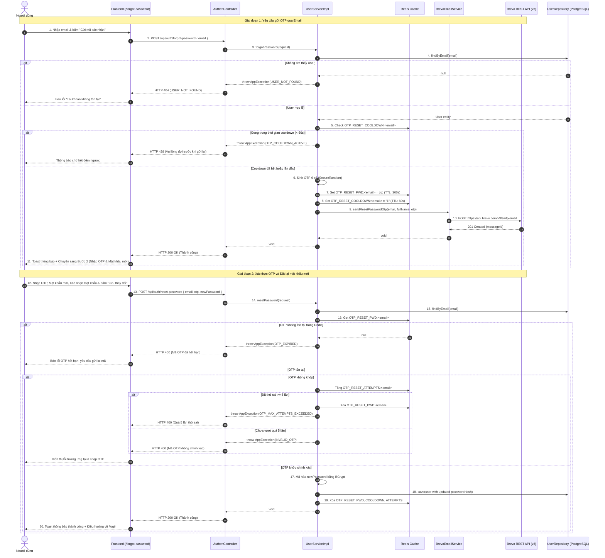

# Thiết Kế Kỹ Thuật: Quên Mật Khẩu & Đặt Lại Mật Khẩu Qua Email OTP (Brevo)

## 1. Mục tiêu & Bối cảnh
- **Mục tiêu:** Cung cấp tính năng khôi phục mật khẩu tài khoản an toàn, tiện lợi và tự động cho người dùng thông qua mã OTP 6 số được gửi về email cá nhân bằng nền tảng Brevo Transactional Email.
- **Đối soát Use Case:** Tham chiếu Use Case `UC003: Quên mật khẩu` trong `docs/DacTa/motaUC_Multilingo.md` (các bước từ 1 đến 11 của luồng chính và luồng thay thế 5a, 9a).
- **Mô hình kiến trúc:** 
  - Frontend: Single Page Application (React 19 + TypeScript + Vite + Tailwind CSS + Lucide Icons).
  - Backend: Spring Boot 3.3.4 (Java 21) + Spring Security + REST API Stateless.
  - Cache & Rate Limiting: Redis (lưu trữ OTP tạm thời, kiểm soát cooldown 60s, giới hạn số lần nhập sai).
  - Email Provider: Brevo (Sendinblue) Transactional REST API v3 qua Spring `RestClient`.
  - Cơ sở dữ liệu: PostgreSQL (lưu hash mật khẩu mới được mã hóa BCrypt trong bảng `users`).

---

## 2. Actors & Phạm vi (Scope)
- **Actors:** Khách vãng lai, Học viên (`STUDENT`), Giảng viên (`TEACHER`), Quản trị viên (`ADMIN`) có tài khoản đăng ký bằng email trong hệ thống.
- **In-Scope (Trong phạm vi):**
  - **Tích hợp Brevo REST API v3:** Sử dụng Spring `RestClient` gọi tới endpoint `https://api.brevo.com/v3/smtp/email` với header `api-key`.
  - **Dịch vụ gửi Email giao dịch (Transactional Email):** Template HTML email chuyên nghiệp mang thương hiệu Multilingo, hiển thị mã OTP 6 số nổi bật, thời hạn 5 phút và hướng dẫn bảo mật.
  - **Vòng đời & Quản lý OTP bằng Redis:**
    - Sinh mã OTP 6 số ngẫu nhiên ngẫu nhiên bảo mật (`SecureRandom`).
    - Lưu Redis `OTP_RESET_PWD:<email>` với TTL 5 phút (300 giây).
    - Rate limit cooldown: Chặn spam gửi lại mã trong 60 giây (`OTP_RESET_COOLDOWN:<email>`).
    - Giới hạn số lần thử sai: `OTP_RESET_ATTEMPTS:<email>`, tối đa 5 lần thử sai -> vô hiệu hóa OTP để chống tấn công brute-force.
    - Hủy OTP ngay sau khi đổi mật khẩu thành công (One-time use).
  - **Backend API Endpoints:**
    - `POST /api/auth/forgot-password`: Kiểm tra tài khoản, sinh OTP, lưu Redis, gửi mail Brevo.
    - `POST /api/auth/reset-password`: Xác thực OTP, kiểm tra mật khẩu hợp lệ (tối thiểu 6 ký tự, khớp xác nhận), mã hóa BCrypt, cập nhật database.
  - **Frontend UI/UX (Wizard 2 bước tại `/forgot-password`):**
    - Bước 1: Form nhập email + Nút "Gửi mã xác nhận" + Link quay lại Đăng nhập.
    - Bước 2: Hiển thị email đã gửi, ô nhập OTP 6 số, ô Mật khẩu mới & Xác nhận mật khẩu (hỗ trợ ẩn/hiện mật khẩu), nút đếm lùi 60s gửi lại mã ("Gửi lại mã (xxs)"), nút "Lưu thay đổi", nút "Thay đổi email" để quay lại Bước 1.
    - Điều hướng từ `LoginForm.tsx`: Bấm "Quên mật khẩu?" dẫn sang `/forgot-password`.
    - Hỗ trợ đa ngôn ngữ (`vi` và `en`).
- **Out-of-Scope (Ngoài phạm vi):**
  - Gửi OTP qua tin nhắn SMS hay Zalo ZNS.
  - Khôi phục tài khoản hoàn toàn bằng Google OAuth2 (không có email mật khẩu truyền thống).

---

## 3. Luồng hoạt động chi tiết (Flow Architecture)



---

## 4. Chi tiết tích hợp Brevo Transactional Email Service

### 4.1. Thông số cấu hình (`application.properties`)
```properties
# Brevo Email API Configuration
brevo.api-key=${BREVO_API_KEY:}
brevo.api-url=${BREVO_API_URL:https://api.brevo.com/v3/smtp/email}
brevo.sender.email=${BREVO_SENDER_EMAIL:no-reply@multilingo.com}
brevo.sender.name=${BREVO_SENDER_NAME:Multilingo Platform}
```

### 4.2. Khởi tạo Client bằng Spring 3 `RestClient`
- Class `BrevoEmailConfig`: Khởi tạo Bean `RestClient` với header `api-key`, `Content-Type: application/json`, `Accept: application/json`.
- Interface `EmailService`:
  ```java
  public interface EmailService {
      void sendResetPasswordOtp(String recipientEmail, String recipientName, String otp);
  }
  ```
- Implementation `BrevoEmailServiceImpl`:
  - Xây dựng Payload gửi đến Brevo:
    ```json
    {
      "sender": {
        "name": "Multilingo Platform",
        "email": "no-reply@multilingo.com"
      },
      "to": [
        {
          "email": "user@example.com",
          "name": "Nguyen Van A"
        }
      ],
      "subject": "Mã xác nhận đặt lại mật khẩu - Multilingo",
      "htmlContent": "<!DOCTYPE html><html>...HTML Template...</html>"
    }
    ```
  - Xử lý lỗi: Nếu `apiKey` rỗng (trong môi trường local chưa cấu hình key thật) -> Ghi log cảnh báo `log.warn(...)` và không ngắt luồng development, đồng thời in OTP ra console để developer test nhanh. Khi có `apiKey`, gọi `restClient.post().body(...).retrieve().toBodilessEntity()`.
  - Nếu Brevo trả về lỗi 4xx/5xx: Ghi log chi tiết và ném `AppException(ErrorCode.UNCATEGORIZED_EXCEPTION)`.

### 4.3. Thiết Kế Email Template với Thymeleaf Engine
- **Thư viện:** `spring-boot-starter-thymeleaf` tích hợp vào `pom.xml`.
- **Cơ chế render:** `BrevoEmailServiceImpl` tiêm Bean `org.thymeleaf.TemplateEngine`, thiết lập `org.thymeleaf.context.Context` chứa các biến:
  - `recipientName`: Tên người nhận (hoặc "Học viên" nếu để trống).
  - `otp`: Mã OTP 6 chữ số.
  - `validMinutes`: Thời gian hết hạn (5 phút).
  - `supportEmail`: Email hỗ trợ `support@multilingo.com`.
- **Vị trí template HTML:** `backend/src/main/resources/templates/email/reset-password-otp.html`
- **Mã xử lý:**
  ```java
  Context context = new Context();
  context.setVariable("recipientName", displayName);
  context.setVariable("otp", otp);
  context.setVariable("validMinutes", 5);
  String htmlContent = templateEngine.process("email/reset-password-otp", context);
  ```
- **Branding & Thẩm mỹ UI Template:**
  - Header: Logo Multilingo 🌐 & tiêu đề thương hiệu.
  - Body: Lời chào cá nhân hóa `th:text="${recipientName}"`.
  - Khung OTP: Card nổi bật với viền cam Terracotta `#c25e2e`, font monospace kích thước lớn (`font-size: 32px; letter-spacing: 8px; font-weight: 800`).
  - Hướng dẫn bảo mật: Cảnh báo mã có hiệu lực trong `5 phút` và không chia sẻ cho người khác.
  - Footer: Thông tin bản quyền Multilingo Platform và lưu ý nếu không phải người gửi yêu cầu.

---

## 5. Chính Sách Quản Lý OTP & Bảo Mật

### 5.1. Redis Key & TTL
| Key | Ý nghĩa | Kiểu dữ liệu | TTL |
| :--- | :--- | :--- | :--- |
| `OTP_RESET_PWD:<email>` | Lưu trữ mã OTP 6 số | String | 300 giây (5 phút) |
| `OTP_RESET_COOLDOWN:<email>` | Chặn spam gửi lại mã liên tục | String ("1") | 60 giây |
| `OTP_RESET_ATTEMPTS:<email>` | Số lần nhập sai OTP | String (Integer) | 300 giây |

### 5.2. Các biện pháp bảo vệ
1. **Chống Brute Force:** Giới hạn tối đa **5 lần** nhập sai. Nếu quá 5 lần, xóa mã OTP ngay lập tức và ném lỗi `OTP_MAX_ATTEMPTS_EXCEEDED` yêu cầu gửi lại từ đầu.
2. **Chống Spam Email:** Cơ chế đếm lùi Cooldown 60s ở cả Client và Server. Server kiểm tra `OTP_RESET_COOLDOWN:<email>` trước khi sinh OTP mới.
3. **Mã hóa an toàn:** Mật khẩu mới bắt buộc được hash bằng `PasswordEncoder` (BCrypt với cost factor tiêu chuẩn).
4. **Xóa dấu vết ngay lập tức:** Ngay khi đổi mật khẩu thành công, toàn bộ các key Redis liên quan đến email đó sẽ bị xóa.

---

## 6. Thiết Kế API Contract

### 6.1. Endpoint Yêu cầu gửi OTP (Forgot Password)
- **URL:** `POST /api/auth/forgot-password`
- **Quyền hạn:** Public (`permitAll`)
- **Headers:** `Content-Type: application/json`

#### Request Body (`ForgotPasswordRequest`):
```json
{
  "email": "student@example.com"
}
```

#### Response Thành công (HTTP 200 OK):
```json
{
  "code": 200,
  "message": "Thao tác thành công",
  "data": null
}
```

#### Response Thất bại:
- `400 BAD_REQUEST`: Email không đúng định dạng.
- `404 NOT_FOUND`: `USER_NOT_FOUND` ("Tài khoản không tồn tại").
- `429 TOO_MANY_REQUESTS`: `OTP_COOLDOWN_ACTIVE` ("Vui lòng đợi 60 giây trước khi yêu cầu mã mới").

---

### 6.2. Endpoint Đặt lại mật khẩu mới (Reset Password)
- **URL:** `POST /api/auth/reset-password`
- **Quyền hạn:** Public (`permitAll`)
- **Headers:** `Content-Type: application/json`

#### Request Body (`ResetPasswordRequest`):
```json
{
  "email": "student@example.com",
  "otp": "123456",
  "newPassword": "myNewPassword123"
}
```

#### Response Thành công (HTTP 200 OK):
```json
{
  "code": 200,
  "message": "Thao tác thành công",
  "data": null
}
```

#### Response Thất bại:
- `400 BAD_REQUEST`: 
  - `INVALID_OTP`: Mã OTP không chính xác.
  - `OTP_EXPIRED`: Mã OTP đã hết hạn hoặc chưa được tạo.
  - `OTP_MAX_ATTEMPTS_EXCEEDED`: Nhập sai quá 5 lần, mã bị hủy.
  - `INVALID_PASSWORD`: Mật khẩu dưới 6 ký tự.
- `404 NOT_FOUND`: `USER_NOT_FOUND`.

---

## 7. Thiết Kế Giao Diện Frontend (UI/UX)

### 7.1. Cấu trúc trang `/forgot-password`
Sử dụng chung layout `AuthLayout` (`frontend/src/features/auth/layouts/AuthLayout.tsx`):
- **Tiêu đề:** "Quên mật khẩu"
- **Mô tả:** 
  - Bước 1: "Nhập email đã đăng ký để nhận mã OTP xác nhận."
  - Bước 2: "Nhập mã OTP vừa nhận qua email và thiết lập mật khẩu mới."

### 7.2. Giao diện Bước 1: Nhập Email
- Ô nhập email (Validation định dạng email).
- Nút bấm chính: `Gửi mã xác nhận` (hiển thị spinner khi `isPending`).
- Nút phụ: `← Quay lại Đăng nhập`.

### 7.3. Giao diện Bước 2: Xác nhận OTP & Đổi Mật khẩu
- Banner thông tin: "Mã OTP đã được gửi đến **{email}**" kèm nút nhỏ `[Thay đổi email]` để quay về bước 1.
- Ô nhập OTP: 6 ô ký tự hoặc 1 input số định dạng `000000` (maxlength 6, tự động focus).
- Ô nhập Mật khẩu mới: Có icon con mắt bật/tắt hiển thị mật khẩu.
- Ô nhập Xác nhận mật khẩu mới: Kiểm tra trùng khớp ngay khi gõ (Realtime match feedback).
- Bộ đếm thời gian gửi lại mã:
  - Nếu `countdown > 0`: `Gửi lại mã sau (xxs)` (nút bị vô hiệu hóa).
  - Nếu `countdown === 0`: `Gửi lại mã OTP` (nút kích hoạt, bấm sẽ gọi lại API forgot-password và reset countdown về 60s).
- Nút bấm chính: `Lưu thay đổi` (Disabled nếu chưa nhập đủ OTP hoặc mật khẩu không khớp).
- Sau khi thành công: Hiển thị Toast thông báo thành công và chuyển hướng về `/login`.
