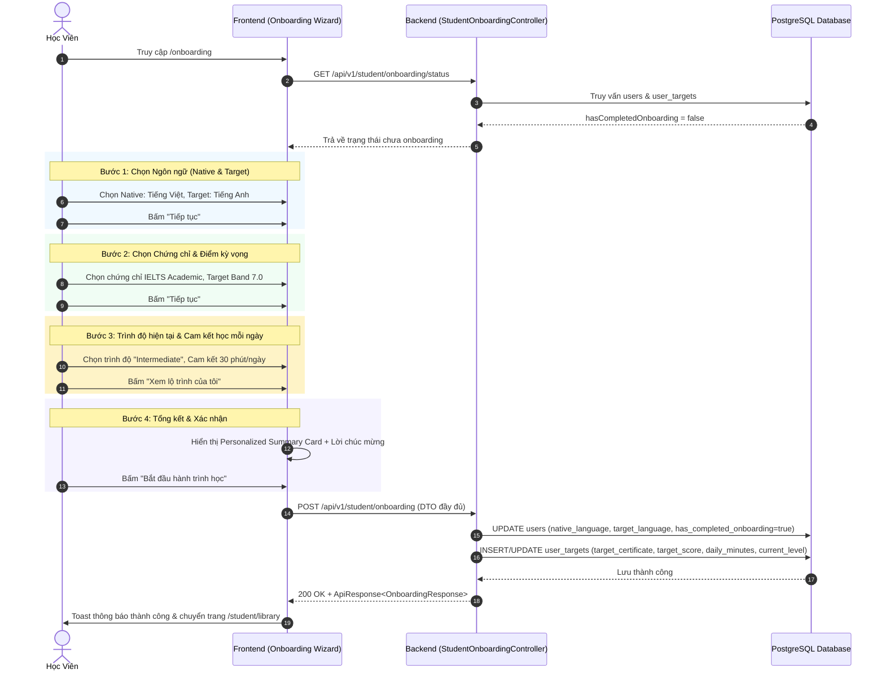

# Đặc Tả Kỹ Thuật: Nâng Cấp Luồng Khởi Tạo Mục Tiêu Học Tập (Student Onboarding Upgrade)

## 1. Mục tiêu & Bối cảnh

### 1.1. Mục tiêu
Nâng cấp toàn diện trải nghiệm Onboarding cho học viên mới khi gia nhập Multilingo Platform:
- **Trực quan hóa lộ trình cá nhân:** Thay thế giao diện Onboarding cũ đơn điệu bằng **Multi-step Interactive Wizard** hiện đại (3 bước tương tác mượt mà, thiết kế chuẩn thẩm mỹ UX/UI cao cấp).
- **Thu thập đầy đủ hồ sơ mục tiêu:** Khảo sát toàn diện về:
  1. **Ngôn ngữ mẹ đẻ & Ngôn ngữ muốn chinh phục** (giới hạn Tiếng Việt 🇻🇳 và Tiếng Anh 🇬🇧, hiển thị cờ SVG vector chuẩn quốc tế).
  2. **Chứng chỉ & Điểm số mục tiêu** (lọc theo ngôn ngữ: Tiếng Anh gồm IELTS Academic, TOEIC L&R, TOEIC Writing; Tiếng Việt gồm NLTV).
  3. **Tổng kết lộ trình cá nhân hóa (Personalized Milestone Summary)** và xác nhận hoàn tất hồ sơ.
- **Lưu trữ dữ liệu chuẩn hóa vào Database (Full-stack):**
  - Cập nhật `native_language`, `target_language`, và cờ `has_completed_onboarding` trong bảng `users`.
  - Lưu bản ghi mục tiêu học tập vào bảng `user_targets`.
  - Khởi tạo thống kê ban đầu trong `user_study_stats` nếu chưa có.

### 1.2. Bối cảnh kiến trúc
- **Frontend:** Feature-Sliced Design đặt tại `frontend/src/features/onboarding/`.
- **Backend Module:** Module `auth` hoặc `student` (`com.multilingo.backend.modules.auth` / `student`).
- **REST Contract:**
  - `GET /api/v1/student/onboarding/status`: Kiểm tra trạng thái đã hoàn thành onboarding của học viên.
  - `POST /api/v1/student/onboarding`: Nộp dữ liệu khảo sát onboarding và lưu vào DB.
- **Tiêu chuẩn:** Controller trả về `ResponseEntity<ApiResponse<T>>`, bắt lỗi ném qua `AppException(ErrorCode.XYZ)`.

---

## 2. Actor & Điều kiện tiên quyết

- **Actor:** Học viên (`STUDENT`) hoặc người dùng vừa đăng ký/đăng nhập lần đầu vào hệ thống.
- **Tiền điều kiện:**
  - Người dùng đã xác thực (có Bearer Token hợp lệ trong header).
  - Chưa từng hoàn tất Onboarding (`has_completed_onboarding = false`).
- **Hậu điều kiện:**
  - Thông tin ngôn ngữ và mục tiêu được lưu thành công vào CSDL.
  - Cờ `has_completed_onboarding = true`.
  - Điều hướng học viên đến Thư viện đề thi (`/student/library`) hoặc Bảng điều khiển (`/student/dashboard`).

---

## 3. Luồng sự kiện chính (Happy Path - 4 Bước Wizard)



---

## 4. Luồng phụ & Ngoại lệ (Edge cases & Business Rules)

1. **Người dùng đã hoàn thành onboarding:**
   - Nếu học viên truy cập `/onboarding` khi `has_completed_onboarding = true`, hệ thống tự động redirect về `/student/dashboard`. Có thể cung cấp nút "Thiết lập lại mục tiêu" trong trang Profile cá nhân nếu muốn thay đổi.
2. **Quay lại bước trước (Back navigation):**
   - Người dùng có thể click "Quay lại" bất kỳ lúc nào để sửa lựa chọn ở các bước trước mà không mất dữ liệu đã chọn.
3. **Validation dữ liệu đầu vào:**
   - `nativeLanguage` và `targetLanguage` không được trùng nhau (không thể chọn vừa học vừa mẹ đẻ là tiếng Việt).
   - `targetCertificate` phải thuộc danh mục hợp lệ: `IELTS_ACADEMIC`, `TOEIC_LR`, `TOEIC_WRITING`, `NLTV`.
   - `targetScore` phải nằm trong khoảng cho phép của từng chứng chỉ:
     * IELTS: `4.0` – `9.0` (bước nhảy `0.5`).
     * TOEIC L&R: `200` – `990` (bước nhảy `5`).
     * TOEIC Writing: `50` – `200` (bước nhảy `10`).
     * NLTV: `3.0` (B1), `4.0` (B2), `5.0` (C1) hoặc điểm tương đương `1.0` – `6.0`.
   - `dailyMinutes` thuộc các mức chuẩn: `15`, `30`, `45`, `60`.
   - `currentLevel` thuộc: `BEGINNER`, `ELEMENTARY`, `INTERMEDIATE`, `ADVANCED`.

---

## 5. Thiết Kế API Contract

### 5.1. `GET /api/v1/student/onboarding/status`
- **Mục đích:** Kiểm tra trạng thái Onboarding của người dùng đang đăng nhập.
- **Headers:** `Authorization: Bearer <accessToken>`
- **Response `200 OK`:**
```json
{
  "code": 200,
  "message": "Thao tác thành công",
  "data": {
    "hasCompletedOnboarding": false,
    "nativeLanguage": "vi",
    "targetLanguage": "en",
    "target": null
  }
}
```

### 5.2. `POST /api/v1/student/onboarding`
- **Mục đích:** Nộp và lưu dữ liệu Onboarding.
- **Headers:** `Authorization: Bearer <accessToken>`
- **Request Body:**
```json
{
  "nativeLanguage": "vi",
  "targetLanguage": "en",
  "targetCertificate": "IELTS_ACADEMIC",
  "targetScore": 7.0,
  "dailyMinutes": 30,
  "currentLevel": "INTERMEDIATE"
}
```
- **Response `200 OK`:**
```json
{
  "code": 200,
  "message": "Thiết lập mục tiêu học tập thành công",
  "data": {
    "userId": 12,
    "nativeLanguage": "vi",
    "targetLanguage": "en",
    "targetCertificate": "IELTS_ACADEMIC",
    "targetScore": 7.0,
    "dailyMinutes": 30,
    "currentLevel": "INTERMEDIATE",
    "hasCompletedOnboarding": true,
    "suggestedExamType": "IELTS_ACADEMIC"
  }
}
```
- **Error Codes:**
  - `400 BAD_REQUEST (ErrorCode.INVALID_REQUEST)`: Dữ liệu thiếu hoặc không hợp lệ.
  - `400 BAD_REQUEST (ErrorCode.LANGUAGE_SAME)`: Ngôn ngữ mẹ đẻ và ngôn ngữ học không được trùng nhau.
  - `401 UNAUTHORIZED (ErrorCode.UNAUTHENTICATED_ACCESS)`: Chưa đăng nhập.

---

## 6. Thiết Kế Database & Flyway Migration

### 6.1. Bảng `user_targets`
Cập nhật thêm 2 cột:
- `daily_minutes INT DEFAULT 30 NOT NULL`
- `current_level VARCHAR(30)`

### 6.2. Bảng `users`
Cập nhật thêm cột:
- `has_completed_onboarding BOOLEAN DEFAULT FALSE NOT NULL`

### 6.3. File Migration Flyway
Tên file: `backend/src/main/resources/db/migration/V20261023111000__add_onboarding_fields_to_user_and_targets.sql`
```sql
-- Migration: Add onboarding fields to users and user_targets tables
ALTER TABLE users 
    ADD COLUMN IF NOT EXISTS has_completed_onboarding BOOLEAN DEFAULT FALSE NOT NULL;

ALTER TABLE user_targets
    ADD COLUMN IF NOT EXISTS daily_minutes INT DEFAULT 30 NOT NULL,
    ADD COLUMN IF NOT EXISTS current_level VARCHAR(30);
```

---

## 7. Thiết Kế Giao Diện UI/UX (Frontend Multi-step Wizard)

Áp dụng tiêu chuẩn từ `ui-ux-pro-max` và `ui-styling`:
1. **Layout & Theme:**
   - Card container trung tâm cân đối (max-width `720px`), hiệu ứng viền kính mờ (glassmorphism/neumorphism tinh tế).
   - Nền gradient nhẹ nhàng, thân thiện với học tập: `#f8fafc` kết hợp vệt màu pastel (`primary-light`).
2. **Step Progress Indicator:**
   - Thanh tiến trình 4 bước hiển thị rõ ràng: `1. Ngôn ngữ` $\rightarrow$ `2. Mục tiêu` $\rightarrow$ `3. Thói quen` $\rightarrow$ `4. Lộ trình`.
   - Hiển thị % hoàn thành (25% $\rightarrow$ 50% $\rightarrow$ 75% $\rightarrow$ 100%).
3. **Tương tác Thẻ Lựa Chọn (Interactive Option Cards):**
   - Các lựa chọn ngôn ngữ, chứng chỉ, thời lượng hiển thị dưới dạng Card có Icon trực quan, hiệu ứng `hover:translate-y(-2px)` và viền active màu tím/xanh đậm (`var(--primary)`).
   - Hỗ trợ phím tắt hoặc click mượt mà không bị giật lag.
4. **Micro-copy & Tone of Voice:**
   - Thân thiện, khích lệ tinh thần học tập ("Chào mừng bạn đến với Multilingo!", "Mục tiêu tuyệt vời! Cùng chinh phục nhé.").
