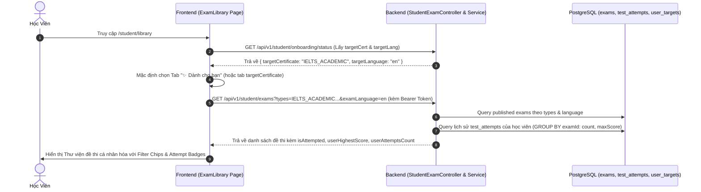

# Đặc Tả Kỹ Thuật: Nâng Cấp Toàn Diện Thư Viện Đề Thi (Exam Library Upgrade)

## 1. Mục tiêu & Bối cảnh

### 1.1. Bối cảnh
Thư viện đề thi (`/student/library`) là trung tâm luyện tập chính của học viên trên Multilingo Platform. Hiện tại, trang thư viện đề còn mang giao diện dạng cột sidebar kiểu cũ với các ô dropdown `<select>` rời rạc, chưa cá nhân hóa theo mục tiêu Onboarding, chưa hỗ trợ theo dõi trạng thái làm bài (học viên không biết mình đã làm đề nào, đạt điểm bao nhiêu).

### 1.2. Mục tiêu kỹ thuật
Nâng cấp toàn diện trang Thư viện đề thi đạt chuẩn thẩm mỹ cao cấp (Modern EdTech UX/UI):
1. **Cá nhân hóa theo Onboarding (Target-Based Smart Filtering):**
   - Tự động nhận diện mục tiêu học tập của học viên (`targetCertificate` & `targetLanguage`).
   - Bổ sung Tab **"Dành cho bạn" (Recommended For You)** ưu tiên hiển thị các đề khớp với chứng chỉ và ngôn ngữ mục tiêu.
   - Thẻ đề thi có Badge đánh dấu `🎯 Khớp mục tiêu`.
2. **Bộ lọc hiện đại (Filter Chips & Segmented Tabs):**
   - Thay thế toàn bộ các ô dropdown `<select>` cũ bằng **Segmented Tabs** và **Filter Chips** có Icon và Cờ quốc gia:
     * Tab Chứng chỉ lớn: `[✨ Dành cho bạn]`, `[Tất cả]`, `[🇬🇧 IELTS]`, `[🇬🇧 TOEIC]`, `[🇻🇳 NLTV]`, `[🌐 Luyện ngôn ngữ]`.
     * Chips Kỹ năng: `[Tất cả]`, `[🎧 Listening]`, `[📖 Reading]`, `[✍️ Writing]`.
     * Chips Phần thi (Part/Passage/Task).
     * Bộ lọc trạng thái làm bài: `[Tất cả]`, `[Chưa làm]`, `[Đã làm]`.
3. **Card Đề thi cao cấp (Premium Exam Card Design):**
   - Thumbnail bo tròn `rounded-2xl`, gradient sống động cho từng loại chứng chỉ, hiệu ứng hover nổi bật (`translate-y-[-6px]`, bóng đổ mềm mại).
   - Hiển thị rõ các pill kỹ năng (Listening / Reading / Writing), số phút, số lượt thi, độ khó.
4. **Theo dõi trạng thái làm bài & Điểm số cá nhân (User Attempt Tracking):**
   - Mở rộng Backend API `/api/v1/student/exams` trả về thông tin làm bài của học viên hiện tại:
     * `isAttempted`: boolean (học viên đã từng làm đề này hay chưa).
     * `userAttemptsCount`: int (số lần đã nộp bài).
     * `userHighestScore`: double (điểm cao nhất từng đạt được).
     * `userLatestScore`: double (điểm của lần thi gần nhất).
   - Trên Card đề thi:
     * Nếu đã làm: Badge xanh lá `✓ Đã làm (2 lần) • Cao nhất: 7.5` hoặc `TOEIC: 850`.
     * Nếu chưa làm: Badge nhẹ `Chưa làm`.
   - Nút hành động: `Làm bài ngay` (nếu chưa làm) hoặc `Làm lại` (nếu đã làm).

---

## 2. Luồng dữ liệu & Sequence Diagram



---

## 3. Thiết kế Giao diện & Trải nghiệm Người dùng (UI/UX Specification)

### 3.1. Hero Section
- **Background:** Gradient ấm áp sang trọng `linear-gradient(135deg, #4f46e5 0%, #7c3aed 50%, #f97316 100%)` với các khối cầu mờ tạo chiều sâu visual.
- **Tiêu đề & Slogan:** *"Thư viện Đề thi Chuẩn hóa"* - Luyện tập thực chiến cùng hàng ngàn đề thi IELTS, TOEIC và NLTV.
- **Banner Mục tiêu học viên:** Hộp nổi bật hiển thị: `🎯 Mục tiêu của bạn: IELTS Academic (Band 7.0) • Cố gắng luyện tập mỗi ngày!` kèm nút chuyển nhanh tới các đề mục tiêu.
- **Thanh tìm kiếm lớn (Live Search Bar):** Bo tròn `rounded-full`, có icon kính lúp, hỗ trợ gõ tìm kiếm tức thì theo tiêu đề đề thi.

### 3.2. Thanh Tabs & Filter Chips (Thay thế Sidebar cũ)
- **Hàng 1: Tabs Chứng chỉ (Segmented Tabs):**
  - `[✨ Dành Cho Bạn]` (Highlight gradient tím-cam)
  - `[Tất Cả]`
  - `[🇬🇧 IELTS]` (Academic & General)
  - `[🇬🇧 TOEIC]` (L&R & Writing)
  - `[🇻🇳 NLTV]` (Đánh giá năng lực tiếng Việt)
  - `[🌐 Luyện Ngôn Ngữ]`
- **Hàng 2: Sub-filter Chips:**
  - **Kỹ năng:** `[Tất cả kỹ năng]` `[🎧 Nghe hiểu]` `[📖 Đọc hiểu]` `[✍️ Viết]`
  - **Trạng thái làm bài:** `[Tất cả đề]` `[Chưa làm]` `[Đã làm]`
  - **Sắp xếp:** `Mới nhất` | `Thi nhiều nhất` | `Điểm cao nhất`

### 3.3. Card Đề thi (Exam Card)
- **Top Thumbnail:**
  - Gradient đặc trưng theo từng chứng chỉ (IELTS: Blue-Indigo; TOEIC: Emerald-Teal; NLTV: Amber-Orange; Language Practice: Violet-Purple).
  - Watermark logo chứng chỉ mờ tinh tế.
  - Badge Trạng thái ở góc trên bên trái:
    * `Chưa làm` (Màu xám/xanh nhạt)
    * `✓ Đã làm (N lần) • Điểm: X.X` (Màu xanh lá emerald nổi bật)
  - Badge Cấp độ ở góc trên bên phải (VD: `Academic`, `General`, `B1-C1`).
  - Nút Play tròn xuất hiện mượt mà khi hover.
- **Nội dung Card:**
  - Tiêu đề đề thi in đậm (`font-bold`, `line-clamp-2`).
  - Hàng kỹ năng: Icons trực quan cho các kỹ năng có trong đề.
  - Hàng thông số: Thời lượng (`⏱️ 60 phút`), Số lượt thi (`👥 1,250 lượt thi`).
  - Nút bấm chính: `Luyện tập ngay ➔` (hoặc `Thi lại ➔` nếu đã làm).

---

## 4. Đặc tả API Backend

### Endpoint: `GET /api/v1/student/exams`
- **Headers:** `Authorization: Bearer <token>` (tùy chọn: nếu có token sẽ kèm thông tin làm bài cá nhân; nếu khách vãng lai thì các trường cá nhân là null).
- **Query Params:**
  - `search`: Chuỗi tìm kiếm tiêu đề.
  - `types`: Danh sách loại đề thi.
  - `examLanguage`: Ngôn ngữ đề (`en`, `vi`,...).
  - `status`: Bộ lọc trạng thái làm bài (`ALL`, `ATTEMPTED`, `UNATTEMPTED`).
  - `sort`: `createdAt` hoặc `popular`.
  - `page`: Trang hiện tại (mặc định 0).
  - `size`: Số bản ghi mỗi trang (mặc định 12).
- **Response Data (`StudentExamSummaryResponse`):**
  ```json
  {
    "id": 101,
    "code": "IELTS-CAM18-TEST1",
    "title": "Cambridge IELTS 18 - Academic Test 1",
    "type": "IELTS_ACADEMIC",
    "examLanguage": "en",
    "level": "Academic",
    "durationMinutes": 60,
    "joins": 1420,
    "tags": ["Listening", "Reading", "Writing"],
    "thumbnailUrl": null,
    "isAttempted": true,
    "userAttemptsCount": 2,
    "userHighestScore": 7.5,
    "userLatestScore": 7.0
  }
  ```
