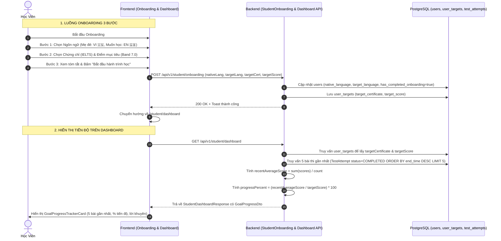

# Đặc Tả Kỹ Thuật: Tinh Giản Onboarding (3 Bước) & Thanh Đo Tiến Độ Mục Tiêu 5 Bài Gần Nhất (Goal Tracker)

## 1. Bối cảnh & Mục tiêu

### 1.1. Bối cảnh
Người dùng đã phê duyệt lược bỏ hoàn toàn phần khảo sát "Thói quen & Trình độ" để luồng Onboarding diễn ra nhanh chóng, nhẹ nhàng và tập trung tuyệt đối vào mục tiêu chính của học viên. Đồng thời, học viên cần thấy được giá trị của việc thiết lập mục tiêu thông qua:
- **Thanh đo tiến độ mục tiêu (Goal Progress Tracker)** trực quan trên Bảng điều khiển học viên (`/student/dashboard`), tính toán dựa trên **điểm số trung bình của 5 bài thi gần nhất** thay vì chỉ dựa vào 1 bài thi đơn lẻ.
- **Tự động áp dụng mục tiêu (Smart Default Filter)** tại Thư viện đề thi (`/student/library`).
- **Từ điển song ngữ theo cặp ngôn ngữ (AI Dictionary Lookup)** tại Phòng thi & Luyện đề.
- **Hồ sơ cá nhân hóa** tại trang Cài đặt tài khoản (`/student/profile`).

### 1.2. Mục tiêu kỹ thuật
1. **Frontend Onboarding Wizard:**
   - Tinh gọn thành **3 bước chuẩn hóa**:
     - **Bước 1: Chọn Ngôn ngữ** (Ngôn ngữ mẹ đẻ 🇻🇳 / Ngôn ngữ muốn học 🇬🇧 kèm cờ quốc gia SVG, thông minh tự động đổi nếu chọn trùng).
     - **Bước 2: Chọn Loại Chứng chỉ & Điểm mục tiêu** (Lọc theo ngôn ngữ muốn học: nếu học tiếng Anh thì hiện IELTS Academic, TOEIC L&R, TOEIC Writing; nếu học tiếng Việt thì hiện NLTV; kèm thanh chọn Band điểm chuẩn hóa).
     - **Bước 3: Lộ trình cá nhân hóa & Xác nhận** (Tổng kết gọn gàng: Ngôn ngữ học ➔ Chứng chỉ ➔ Điểm số kỳ vọng, kèm nút kích hoạt học tập).
   - Xóa bỏ hoàn toàn component `Step3HabitAndLevel.tsx`.
2. **Backend Dashboard Service & DTO:**
   - Mở rộng DTO `StudentDashboardResponse` thêm object `GoalProgressDto` chứa:
     - `targetCertificate`: Mã chứng chỉ mục tiêu (`IELTS_ACADEMIC`, `TOEIC_LR`, `TOEIC_WRITING`, `NLTV`).
     - `targetScore`: Điểm mục tiêu đã đặt từ Onboarding.
     - `recentAverageScore`: Điểm trung bình của **tối đa 5 bài thi đã hoàn thành gần nhất**.
     - `progressPercent`: Tỷ lệ % hoàn thành mục tiêu (`recentAverageScore / targetScore * 100`, tối đa 100%).
     - `recentScores`: Mảng danh sách tối đa 5 điểm số gần nhất kèm ngày thi để vẽ biểu đồ mini sparkline / tiến trình.
     - `recentExamCount`: Số lượng bài thi đã làm trong tập 5 bài (từ 0 đến 5).
3. **Frontend Dashboard UI:**
   - Xây dựng component mới **`GoalProgressTrackerCard.tsx`** đặt nổi bật trên Bảng điều khiển (`/student/dashboard`).
   - Hiển thị badge chứng chỉ, điểm mục tiêu, điểm trung bình 5 bài gần nhất, thanh tiến trình % có hiệu ứng gradient bo góc và 5 điểm mốc (dots/pills) trực quan.

---

## 2. Kiến trúc & Dữ liệu (Data Flow)

### 2.1. Sequence Diagram: Luồng Onboarding 3 bước & Đồng bộ Dashboard



---

## 3. Chi tiết Dữ liệu & Business Rules

### 3.1. Quy tắc tính toán Tiến độ mục tiêu (5 bài gần nhất)
1. **Tập dữ liệu đầu vào:**
   - Lấy danh sách tối đa **5 bài thi gần nhất** có trạng thái `COMPLETED` của học viên, sắp xếp theo thời gian nộp bài giảm dần (`end_time DESC` hoặc `created_at DESC`).
   - Chỉ tính các bài thi tương thích hoặc tính trung bình điểm số theo thang chuẩn của chứng chỉ mục tiêu.
2. **Quy tắc làm tròn & Điểm trung bình:**
   - `recentAverageScore`: Làm tròn 1 chữ số thập phân đối với IELTS / NLTV (ví dụ: `6.3`); làm tròn số nguyên đối với TOEIC (ví dụ: `685`).
3. **Quy tắc tính tỷ lệ tiến độ (`progressPercent`):**
   - Nếu học viên chưa làm bài nào (`recentExamCount == 0`): `progressPercent = 0%`, hiển thị trạng thái chờ kiểm tra năng lực đầu vào.
   - Nếu học viên đã làm từ 1 đến 5 bài:
     $$\text{progressPercent} = \min\left(100\%, \text{Math.round}\left(\frac{\text{recentAverageScore}}{\text{targetScore}} \times 100\right)\right)$$
4. **Hiển thị 5 điểm mốc (Sparkline Dots/Pills):**
   - Mỗi viên thuốc (pill) biểu thị điểm số của 1 bài thi từ cũ nhất đến mới nhất trong 5 bài:
     * Ví dụ: `[5.5] ➔ [6.0] ➔ [6.0] ➔ [6.5] ➔ [7.0]`
     * Giúp học viên nhìn thấy ngay quỹ đạo tiến bộ thực tế của bản thân.

---

## 4. Các điểm xuất hiện của thông tin Onboarding trên toàn hệ thống

| Vị trí | Đường dẫn | Nội dung hiển thị & Thay đổi |
| :--- | :--- | :--- |
| **Bảng điều khiển** | `/student/dashboard` | 1. **Greeting Header:** Badge cờ ngôn ngữ đang học & tên chứng chỉ mục tiêu.<br>2. **Goal Progress Tracker Card:** Thanh đo tiến độ 5 bài gần nhất, so sánh với `targetScore`, 5 viên thuốc điểm số và tỷ lệ % hoàn thành. |
| **Thư viện đề thi** | `/student/library` | **Smart Default Filter:** Tự động lọc đề theo `target_certificate` và `target_language` khi vào thư viện lần đầu. Học viên thấy ngay đề phù hợp. |
| **Phòng thi & Luyện tập** | `/student/exams/...` | **AI Dictionary & Hints:** Sử dụng cặp ngôn ngữ `target_language` (ngôn ngữ đề) ➔ `native_language` (ngôn ngữ giải nghĩa). |
| **Hồ sơ cá nhân** | `/student/profile` | Khu vực **"Mục tiêu học tập"**: Xem thông tin mục tiêu hiện tại và nút **"Chỉnh sửa mục tiêu"** để cập nhật khi cần. |

---

## 5. Tiêu chí nghiệm thu (Acceptance Criteria - Gherkin)

```gherkin
Feature: Onboarding 3 bước & Thanh đo tiến độ mục tiêu 5 bài gần nhất

  Scenario: Học viên hoàn thành Onboarding 3 bước tinh giản
    Given Học viên vừa đăng ký tài khoản và truy cập /onboarding
    When Học viên hoàn thành Bước 1 (Chọn Tiếng Việt 🇻🇳 và Tiếng Anh 🇬🇧)
    And Học viên hoàn thành Bước 2 (Chọn IELTS Academic và Band 7.0)
    And Tại Bước 3, học viên thấy tóm tắt (Tiếng Việt -> Tiếng Anh, IELTS Academic, Band 7.0) không có phần thói quen trình độ
    And Học viên bấm "Bắt đầu hành trình học"
    Then Hệ thống lưu thành công vào CSDL và chuyển hướng về /student/dashboard

  Scenario: Bảng điều khiển hiển thị tiến độ mục tiêu từ 5 bài thi gần nhất
    Given Học viên có mục tiêu IELTS Academic Band 7.0 và đã hoàn thành 5 bài thi gần nhất với điểm [5.5, 6.0, 6.0, 6.5, 6.5]
    When Học viên mở /student/dashboard
    Then Điểm trung bình hiển thị là 6.1
    And Tỷ lệ tiến độ mục tiêu hiển thị là 87% (6.1 / 7.0)
    And Danh sách 5 viên thuốc điểm số hiển thị theo thứ tự thời gian

  Scenario: Thư viện đề thi tự động chọn đúng chứng chỉ mục tiêu của học viên
    Given Học viên đã đặt mục tiêu là TOEIC_LR trong Onboarding
    When Học viên truy cập /student/library
    Then Bộ lọc chứng chỉ được chọn sẵn là TOEIC
    And Danh sách đề thi hiển thị các đề TOEIC tương ứng
```
